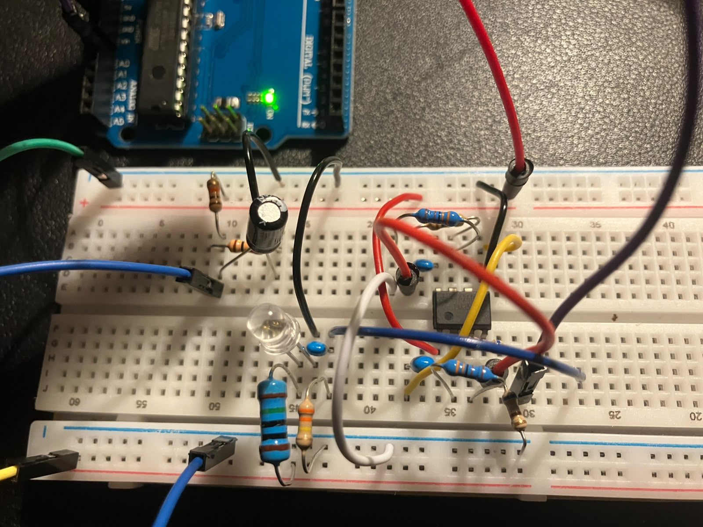
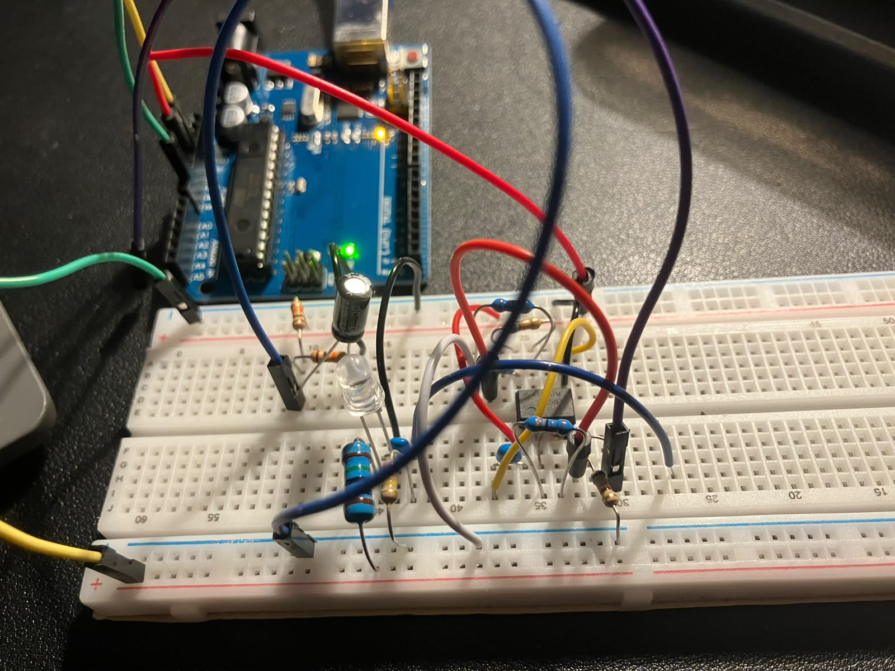
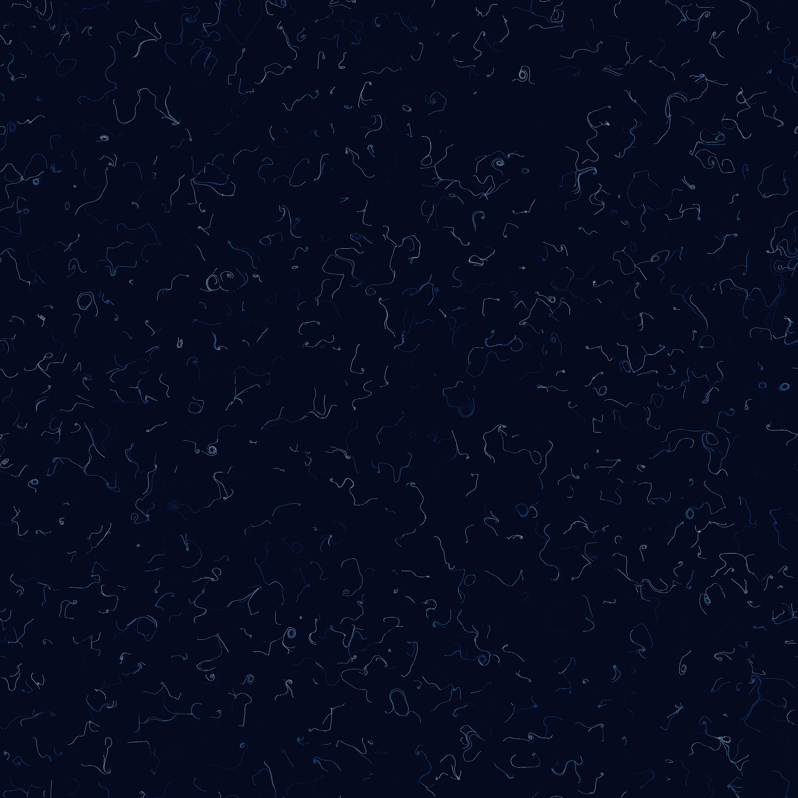

# Hardware QRNG Investigation

This is my attempt to investigate whether a circuit built around a green LED, an LM358 op amp and an Arduino can serve as a physical entropy source, using a set of analysis tools to evaluate its output. I also generated [cool art](#art) using the bitstream, which you should check out. Refer to the [repository guide](#repositoryguide) and use the [contents section](#contents) to access everything more easily. Enjoy your time here :)) (BE SURE TO READ THE "IMPORTANT" SECTIONS!)

**Author:** Trishan Biswas  
**Project started:** December 2025  
**First complete demonstrator and dataset:** April 2026

| ED-1 bit balance and software comparison | ED-2 latest breadboard build |
|:---:|:---:|
|  |  |
| ED-1 output compared with a deterministic Mersenne Twister control. Similar results do not establish physical origin or security. | Latest documented ED-2 arrangement, retained as a development build rather than a validated entropy source. |

## Contents

[Overview](#overview) | [Quick terminology](#terminology) | [Development](#development) | [ED 1 results](#ed1results) | [ED 2 circuit](#ed2circuit) | [ED 3 circuit](#ed3circuit) | [ED 4 enclosure](#ed4enclosure) | [Hardware photographs](#photographs) | [Repository guide](#repositoryguide) | [Reproducing the analysis](#analysis) | [Collecting new data](#collection) | [Bitstream Art](#art) | [Limits](#limits) | [Next work](#nextwork) | [Licence](#licence)

<a id="overview"></a>
## Overview

The project is organised into four experimental demonstrators.

| Stage | Purpose | Current state |
|---|---|---|
| **ED-1** | Prove that the full path from circuit to saved data and analysis could work | Complete and preserved |
| **ED-2** | Explore a documented two-stage analogue path and acquisition process | Preserved as a breadboard development stage; reference loading found during bring-up |
| **ED-3** | Test a simpler circuit with a buffered reference and one signal-gain stage | Design documented; assembly and validation pending |
| **ED-4** | Transfer a verified circuit to perfboard and place it in a stable enclosure | Enclosure printed and perfboard fit confirmed; electrical transfer pending ED-3 validation |

The name QRNG describes the research direction. The present evidence supports an experimental physical entropy source, not a certified quantum random number generator or a source suitable for cryptographic use.

The investigation asks three practical questions:

1. Does the circuit produce measurable physical noise?
2. Can useful digital bits be extracted from it consistently?
3. Do the results survive repeat captures, restarts and control experiments?

Statistical tests can describe a bitstream, but they cannot identify its physical origin on their own. The circuit, sampling process and possible interference must be studied alongside the output.

<a id="terminology"></a>
## Quick terminology

| Term | Meaning in this project |
|---|---|
| **Entropy source** | A physical process being investigated as a possible source of unpredictable variation |
| **ADC reading** | A number produced when the Arduino converts the measured circuit voltage into a digital value |
| **Least significant bit** | The final binary digit of an ADC reading, recorded here as a candidate random bit |
| **Bitstream** | The resulting sequence of zeros and ones |
| **Software control** | A deterministic Mersenne Twister sequence used for comparison, not a NIST reference generator |
| **Bitstream Art** | Visuals drawn by custom Python programs whose choices are driven by the recorded ED-1 bits. No generative AI model was used |
| **ED** | Entropy Demonstrator |

The analysis checks balance, repetition, correlation and stability. A balanced output alone does not prove that the signal is quantum or secure.

<a id="development"></a>
## Development

I began the project in December 2025 because it combined semiconductor physics, analogue electronics, microcontroller sampling and Python analysis in one experiment.

In April 2026, ED-1 became the first complete demonstrator. It produced a saved sequence of one million ADC readings and one least significant bit from each reading. I then built a software control, generated comparison figures and ran exploratory statistical tests.

> [!IMPORTANT]
> The first result looked promising because the extracted bits were close to balanced. A later audit showed that the raw ADC sequence contained strong correlation and a repeating component. This did not make ED-1 useless. It made ED-1 a clear baseline and showed what the next version needed to improve.

ED-2 kept the original LED source idea but added a defined midpoint reference, two amplifier stages, clearer bias paths, supply decoupling and output protection. During systematic bring-up, the Stage A reference branch pulled the unbuffered midpoint from approximately 2.5 V to approximately 1.3 V. That result is preserved as part of the engineering record rather than presented as a validated improvement.

ED-3 starts again with a simpler topology. One LM358 section buffers the midpoint reference and the other provides a single signal-gain stage. ED-4 is the later mechanical stage: an 89 by 52 mm perfboard and removable enclosure after ED-3 has passed electrical and data checks. The ED-4 shell has now been printed and the bare perfboard has passed its first physical fit check.

<a id="ed1results"></a>
## ED 1 results

The preserved April 2026 capture contains 1,000,000 samples.

| Measurement | Result |
|---|---:|
| Ones | 497,767 |
| Zeros | 502,233 |
| Proportion of ones | 0.497767 |
| Binary Shannon entropy | 0.9999856 bits per bit |
| Most common value estimate | 0.9935713 bits per bit |
| Raw ADC range | 0 to 760 |
| Raw ADC lag 1 correlation | 0.9057 |
| Dominant raw period | approximately 14.87 samples |
| Extracted bit lag 1 correlation | 0.00119 |

The bit balance was encouraging, but the raw ADC correlation showed that the analogue signal contained substantial structure. The exploratory NIST STS run also reported failures in Frequency, Runs and forward Cumulative Sums. These results are kept in the repository because they are part of the engineering record.


The full interpretation is recorded in [`docs/validation.md`](docs/validation.md).

<a id="ed2circuit"></a>
## ED 2 circuit

ED-2 uses the following signal path:

1. A green LED is connected as the proposed physical noise source.
2. A 2.5 V midpoint reference supports operation from a single 5 V supply.
3. Two LM358 noninverting stages amplify the alternating component of the signal.
4. A protected output feeds Arduino input A0.
5. The Arduino records each raw ADC code and its least significant bit.
6. A steady D7 indicator shows that the sampler is running without switching for every recorded bit.

The exact component values, breadboard positions, expected voltages and assembly order are documented in [`circuit.md`](circuit.md). The matching sampler is stored at [`firmware/ED-2/entropy_sampler_ed2.ino`](firmware/ED-2/entropy_sampler_ed2.ino).

ED-2 produced live ADC readings, but systematic probing exposed reference loading in the assembled topology. It has no published validation dataset and is retained as a development stage rather than a verified source.

<a id="ed3circuit"></a>
## ED 3 circuit

ED-3 uses a buffered midpoint reference and one signal amplifier. The reduced
topology removes the second signal-gain stage and prevents the gain network from
directly loading the 10 kOhm midpoint divider.

The proposed component values, electrical netlist and staged bring-up sequence
are documented in [`hardware/ED-3/circuit.md`](hardware/ED-3/circuit.md). The
matching sampler is stored at
[`firmware/ED-3/entropy_sampler_ed3.ino`](firmware/ED-3/entropy_sampler_ed3.ino).
ED-3 will not be described as working until its reference, amplifier baseline,
source controls and repeat captures have been checked.

<a id="ed4enclosure"></a>
## ED 4 enclosure

The ED-4 case is a two part parametric design for the planned perfboard build. The base has been printed successfully, and the intended 89 by 52 mm perfboard fits between the locating features. This confirms the initial board envelope only; it does not yet confirm component clearance, cable routing or electrical operation.

| Dimension | Value |
|---|---:|
| Perfboard | 89 by 52 mm |
| Internal space | 105 by 68 by 34 mm |
| Approximate assembled exterior | 109.8 by 72.8 by 40 mm |
| Board support height | 8 mm |
| Clearance above the board | approximately 24.4 mm |
| Cable opening | 26 by 12 mm |

The cable opening accommodates the currently planned Arduino connections: 5 V, 3.3 V, GND and A0. Arduino AREF remains unconnected.

The editable source, printable files, dimensions and print guidance are available in the [ED-4 CAD directory](hardware/ED-4/cad/README.md).

| Printed ED-4 enclosure base | Initial perfboard fit check |
|:---:|:---:|
|  |  |
| The first physical print of the enclosure base and internal locating features. | The intended 89 by 52 mm perfboard seated in the printed base before component transfer. |

<a id="photographs"></a>
## Hardware photographs

The photographs keep the demonstrators visually separate so their wiring and mechanical progress cannot be mistaken for the same revision.

| ED-1 first demonstrator | ED-2 improved breadboard |
|---|---|
|  |  |
| Original breadboard used for the first complete acquisition and analysis path. | Wider view of the latest documented ED-2 breadboard with its Arduino connection. |

Additional views and captions are stored in the [ED-1 hardware notes](hardware/ED-1/README.md), [ED-2 hardware notes](hardware/ED-2/README.md) and [ED-4 enclosure notes](hardware/ED-4/README.md).

<a id="repositoryguide"></a>
## Repository guide

| Location | Contents |
|---|---|
| [`art/`](art/README.md) | Reproducible artwork driven by the saved ED-1 bits |
| [`data/`](data/README.md) | Preserved captures, controls and integrity hashes |
| [`docs/`](docs/development-log.md) | Development history, theory, limits, safety and validation plans |
| [`figures/ED-1/`](figures/ED-1/) | Figures generated from the April 2026 capture |
| [`firmware/`](firmware/README.md) | Arduino samplers separated by demonstrator |
| [`hardware/`](hardware/README.md) | Photographs, build records, the ED-3 circuit and ED-4 CAD |
| [`results/`](results/README.md) | The ED-1 audit and exploratory statistical output |
| [`software/`](software/) | Collection, analysis, comparison and extraction tools |
| [`tests/`](tests/) | Data, link, asset, analysis and CAD integrity tests |

<a id="analysis"></a>
## Reproducing the analysis

Install the Python dependencies from the repository root:

```bash
python -m pip install -r requirements.txt
```

Run the repository tests:

```bash
python -m unittest discover -s tests -v
```

Regenerate the ED-1 diagnostics and comparison:

```bash
python software/analyser.py
python software/compare.py
```

The exploratory NIST wrapper requires a separately installed NIST STS executable. Read [`docs/validation.md`](docs/validation.md) before interpreting its output.

<a id="collection"></a>
## Collecting new data

After ED-3 passes bring-up, upload the ED-3 sampler, confirm the serial port and run:

```bash
python software/collector.py --port COM3 --samples 1000000
```

Replace `COM3` with the port used by the Arduino. The collector writes a new timestamped CSV and a JSON metadata file under `data/ED-3/runs/`. A capture should not be published until the circuit values, firmware version, conditions and file hash have been recorded.

<a id="art"></a>
## Bitstream Art

The repository includes four artworks drawn deterministically from the ED-1 bitstream by custom Python programs. The recorded bits control visual choices such as paths, positions and colours. No generative AI model was used, and the artwork is not evidence of randomness quality.



The images and reproducible source code are available in the [`art` gallery](art/README.md).

<a id="limits"></a>
## Limits

The project has not yet isolated the contribution of the LED from amplifier noise, converter behaviour, supply movement or environmental interference. ED-1 represents one capture, ED-2 exposed a reference-loading problem, and ED-3 still needs assembly and controlled testing.

> [!CAUTION]
> No output from this repository should be used for cryptographic keys, authentication, gambling, financial decisions or safety critical systems.

Read [`docs/limitations.md`](docs/limitations.md), [`docs/safety.md`](docs/safety.md) and [`SECURITY.md`](SECURITY.md) before reproducing the hardware.

<a id="nextwork"></a>
## Next work

1. Assemble ED-3 in tested stages, beginning with the buffered reference.
2. Record the final component values, node checks and build photographs.
3. Capture ED-3 controls and source runs across independent restarts.
4. Compare its raw signal structure, bias, correlation and stability with ED-1.
5. Establish a conservative entropy estimate before introducing conditioning.
6. Transfer only a verified topology to the ED-4 perfboard and enclosure.

<a id="licence"></a>
## Licence

The hardware, analysis and documentation are released under the Apache License 2.0 in [`LICENSE`](LICENSE). The Bitstream Art directory retains its MIT licence in [`art/LICENSE`](art/LICENSE).
