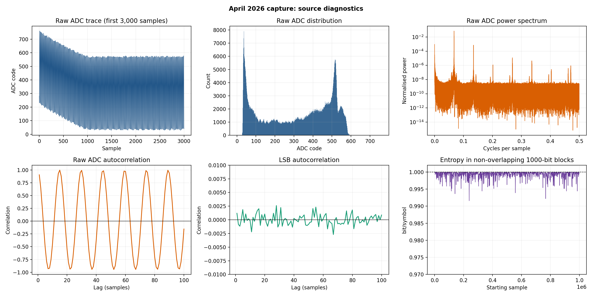
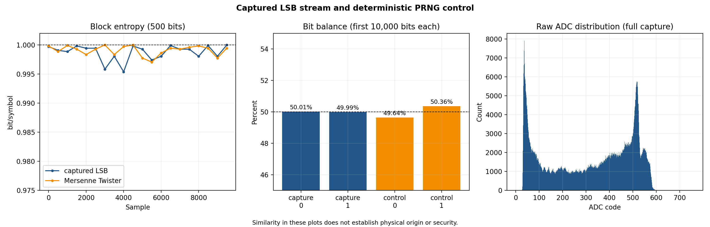
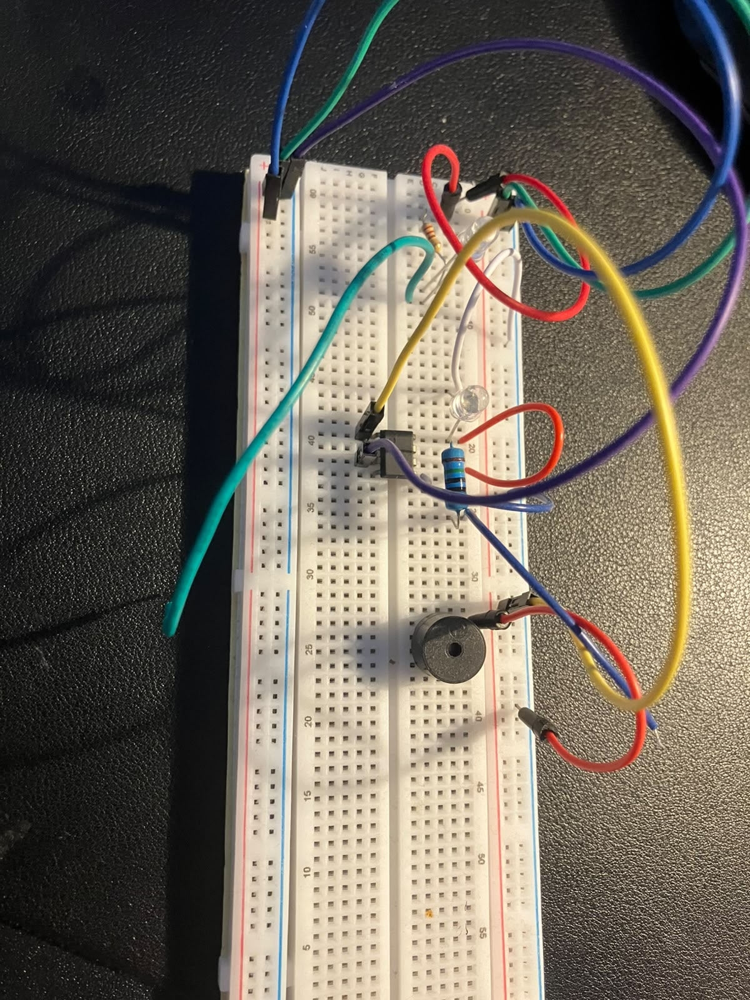

# Hardware QRNG Investigation

This repository records my attempt to build and understand a physical entropy source using a green LED, an LM358 amplifier, an Arduino and a set of analysis tools.

**Author:** Trishan Biswas  
**Project started:** December 2025  
**First complete demonstrator and dataset:** April 2026

## Contents

[Overview](#overview) | [Development](#development) | [ED 1 results](#ed1results) | [ED 2 circuit](#ed2circuit) | [ED 3 enclosure](#ed3enclosure) | [Hardware photographs](#photographs) | [Repository guide](#repositoryguide) | [Reproducing the analysis](#analysis) | [Collecting new data](#collection) | [Generative art](#art) | [Limits](#limits) | [Next work](#nextwork) | [Licence](#licence)

<a id="overview"></a>
## Overview

The project has progressed through three experimental demonstrators.

| Stage | Purpose | Current state |
|---|---|---|
| **ED-1** | Prove that the full path from circuit to saved data and analysis could work | Complete and preserved |
| **ED-2** | Improve the analogue path, circuit record and acquisition process | Built and producing ADC readings |
| **ED-3** | Move the circuit to perfboard and place it in a stable enclosure | CAD complete, physical assembly pending |

The name QRNG describes the research direction. The present evidence supports an experimental physical entropy source, not a certified quantum random number generator or a source suitable for cryptographic use.

The investigation asks three practical questions:

1. Does the circuit produce measurable physical noise?
2. Can useful digital bits be extracted from it consistently?
3. Do the results survive repeat captures, restarts and control experiments?

Statistical tests can describe a bitstream, but they cannot identify its physical origin on their own. The circuit, sampling process and possible interference must be studied alongside the output.

<a id="development"></a>
## Development

I began the project in December 2025 because it combined semiconductor physics, analogue electronics, microcontroller sampling and Python analysis in one experiment.

In April 2026, ED-1 became the first complete demonstrator. It produced a saved sequence of one million ADC readings and one least significant bit from each reading. I then built a software control, generated comparison figures and ran exploratory statistical tests.

The first result looked promising because the extracted bits were close to balanced. A later audit showed that the raw ADC sequence contained strong correlation and a repeating component. This did not make ED-1 useless. It made ED-1 a clear baseline and showed what the next version needed to improve.

ED-2 kept the original LED source idea but added a defined midpoint reference, two amplifier stages, clearer bias paths, supply decoupling, output protection and a separate collection status indicator. The build also gained a complete breadboard record and a collector that writes timestamps and metadata.

ED-3 takes the next mechanical step. It is designed around an 89 by 52 mm perfboard, a removable enclosure and a five wire connection to the Arduino. The circuit still needs to be transferred and tested inside the enclosure before ED-3 can be described as an operating demonstrator.

<a id="ed1results"></a>
## ED 1 results

The preserved April 2026 capture contains 1,000,000 samples.

| Measurement | Result |
|---|---:|
| Ones | 497,767 |
| Zeros | 502,233 |
| Proportion of ones | 0.497767 |
| Binary Shannon entropy | 0.9999856 bits per bit |
| Most common value estimate | 0.9935713 bits per bit |
| Raw ADC range | 0 to 760 |
| Raw ADC lag 1 correlation | 0.9057 |
| Dominant raw period | approximately 14.87 samples |
| Extracted bit lag 1 correlation | 0.00119 |

The bit balance was encouraging, but the raw ADC correlation showed that the analogue signal contained substantial structure. The exploratory NIST STS run also reported failures in Frequency, Runs and forward Cumulative Sums. These results are kept in the repository because they are part of the engineering record.





The full interpretation is recorded in [`docs/validation.md`](docs/validation.md).

<a id="ed2circuit"></a>
## ED 2 circuit

ED-2 uses the following signal path:

1. A green LED is connected as the proposed physical noise source.
2. A 2.5 V midpoint reference supports operation from a single 5 V supply.
3. Two LM358 noninverting stages amplify the alternating component of the signal.
4. A protected output feeds Arduino input A0.
5. The Arduino records each raw ADC code and its least significant bit.
6. A steady D7 indicator shows that the sampler is running without switching for every recorded bit.

The exact component values, breadboard positions, expected voltages and assembly order are documented in [`circuit.md`](circuit.md). The matching sampler is stored at [`firmware/ED-2/entropy_sampler_ed2.ino`](firmware/ED-2/entropy_sampler_ed2.ino).

ED-2 has produced live ADC readings, but it does not yet have a published validation dataset. Its performance will be measured directly rather than inferred from ED-1.

<a id="ed3enclosure"></a>
## ED 3 enclosure

The ED-3 case is a two part parametric design for the planned perfboard build.

| Dimension | Value |
|---|---:|
| Perfboard | 89 by 52 mm |
| Internal space | 105 by 68 by 65 mm |
| Approximate assembled exterior | 109.8 by 72.8 by 71 mm |
| Board support height | 8 mm |
| Clearance above the board | approximately 55.4 mm |
| Cable opening | 26 by 12 mm |

The cable opening carries five Arduino connections: 5 V, 3.3 V, GND, A0 and D7. Arduino AREF remains unconnected.

The editable source, printable files, dimensions and print guidance are available in the [ED-3 CAD directory](hardware/ED-3/cad/README.md).

<a id="photographs"></a>
## Hardware photographs

The photographs keep ED-1 and ED-2 visually separate so their wiring cannot be mistaken for the same circuit revision.

| ED-1 first demonstrator | ED-2 improved breadboard |
|---|---|
|  |  |
| Original breadboard used for the first complete acquisition and analysis path. | Later breadboard with the revised analogue arrangement and status indicator. |

Additional views and captions are stored in the [ED-1 hardware notes](hardware/ED-1/README.md) and [ED-2 hardware notes](hardware/ED-2/README.md).

<a id="repositoryguide"></a>
## Repository guide

| Location | Contents |
|---|---|
| [`art/`](art/README.md) | Reproducible artwork driven by the saved ED-1 bits |
| [`data/`](data/README.md) | Preserved captures, controls and integrity hashes |
| [`docs/`](docs/development-log.md) | Development history, theory, limits, safety and validation plans |
| [`figures/ED-1/`](figures/ED-1/) | Figures generated from the April 2026 capture |
| [`firmware/`](firmware/README.md) | Arduino samplers separated by demonstrator |
| [`hardware/`](hardware/README.md) | Photographs, build records, metadata templates and ED-3 CAD |
| [`results/`](results/README.md) | The ED-1 audit and exploratory statistical output |
| [`software/`](software/) | Collection, analysis, comparison and extraction tools |
| [`tests/`](tests/) | Data, link, asset, analysis and CAD integrity tests |

<a id="analysis"></a>
## Reproducing the analysis

Install the Python dependencies from the repository root:

```bash
python -m pip install -r requirements.txt
```

Run the repository tests:

```bash
python -m unittest discover -s tests -v
```

Regenerate the ED-1 diagnostics and comparison:

```bash
python software/analyser.py
python software/compare.py
```

The exploratory NIST wrapper requires a separately installed NIST STS executable. Read [`docs/validation.md`](docs/validation.md) before interpreting its output.

<a id="collection"></a>
## Collecting new data

Upload the ED-2 sampler, confirm the serial port and run:

```bash
python software/collector.py --port COM3 --samples 1000000
```

Replace `COM3` with the port used by the Arduino. The collector writes a new timestamped CSV and a JSON metadata file under `data/ED-2/runs/`. A capture should not be published until the circuit values, firmware version, conditions and file hash have been recorded.

<a id="art"></a>
## Generative art

The repository includes four artworks generated deterministically from the ED-1 bitstream. They show a traceable creative use of recorded hardware data. They are not evidence of randomness quality.

The images and reproducible source code are available in the [`art` gallery](art/README.md).

<a id="limits"></a>
## Limits

The project has not yet isolated the contribution of the LED from amplifier noise, converter behaviour, supply movement or environmental interference. ED-1 represents one capture, while ED-2 still needs a controlled data campaign. No output from this repository should be used for cryptographic keys, authentication, gambling, financial decisions or safety critical systems.

Read [`docs/limitations.md`](docs/limitations.md), [`docs/safety.md`](docs/safety.md) and [`SECURITY.md`](SECURITY.md) before reproducing the hardware.

<a id="nextwork"></a>
## Next work

1. Transfer the ED-2 circuit to the ED-3 perfboard.
2. Print the ED-3 base and lid and check the physical fit.
3. Record the final component values, supply voltages and build photographs.
4. Capture ED-2 and ED-3 control datasets across independent restarts.
5. Compare their raw signal structure, bias, correlation and stability with ED-1.
6. Establish a conservative entropy estimate before introducing conditioning.

<a id="licence"></a>
## Licence

The hardware, analysis and documentation are released under the Apache License 2.0 in [`LICENSE`](LICENSE). The generative art directory retains its MIT licence in [`art/LICENSE`](art/LICENSE).
