# Hardware QRNG Investigation

This is my attempt to investigate whether a circuit built around a green LED, an LM358 op amp and an Arduino can serve as a physical entropy source, using a set of analysis tools to evaluate its output. I also generated [cool art](#art) using the bitstream, which you should check out. Refer to the [repository guide](#repositoryguide) and use the [contents section](#contents) to access everything more easily. Enjoy your time here :)) (BE SURE TO READ THE "IMPORTANT" SECTIONS!)

**Author:** Trishan Biswas  
**Project started:** December 2025  
**First complete demonstrator and dataset:** April 2026

| ED-1 bit balance and software comparison | ED-2 latest breadboard build |
|:---:|:---:|
| 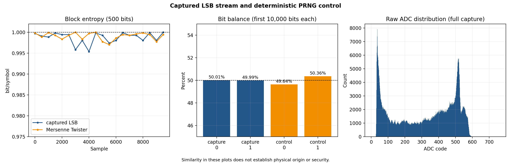 | 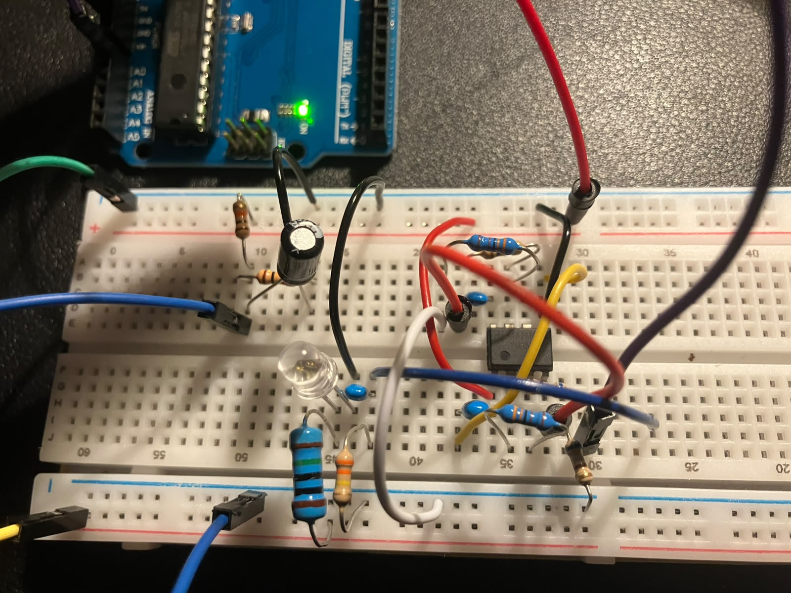 |
| ED-1 output compared with a deterministic Mersenne Twister control. Similar results do not establish physical origin or security. | Latest documented ED-2 arrangement, retained as a development build rather than a validated entropy source. |

**ED4 A signal path simulation:** A small test signal is amplified to the expected
Arduino input range in an approximate ngspice model. The LED source remains to
be measured. [Simulation details](hardware/ED-4/pcb/ED4-A/simulation/README.md).

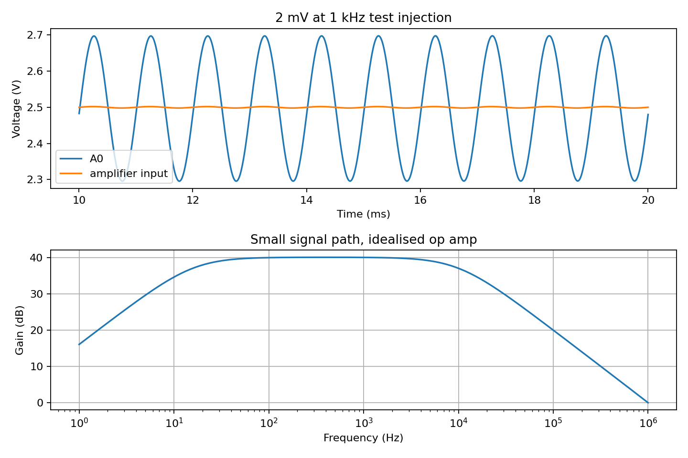

## Contents

[MATLAB analysis](#matlab) | [ED4 PCB](#ed4pcb) | [PCB views](#pcbviews) | [ngspice checks](#ngspicechecks) | [Overview](#overview) | [Quick terminology](#terminology) | [Development](#development) | [ED 1 results](#ed1results) | [ED 2 circuit](#ed2circuit) | [ED 3 circuit](#ed3circuit) | [ED 4 enclosure](#ed4enclosure) | [Hardware photographs](#photographs) | [Repository guide](#repositoryguide) | [Reproducing the analysis](#analysis) | [Collecting new data](#collection) | [Bitstream Art](#art) | [Limits](#limits) | [Next work](#nextwork) | [Licence](#licence)

<a id="matlab"></a>
## MATLAB analysis

I used MATLAB to examine the original million sample Arduino capture through
signal traces, ADC distributions, a Hann windowed FFT, autocorrelation and bit
balance across consecutive blocks. The analysis runs without extra toolboxes.

The proportion of ones is 0.497767, but the raw ADC correlation at lag 1 is
0.9057 and the strongest spectral component repeats every 14.87 samples.
The extracted bits look nearly balanced while the original signal has clear
structure. That distinction guides the next round of circuit measurements.

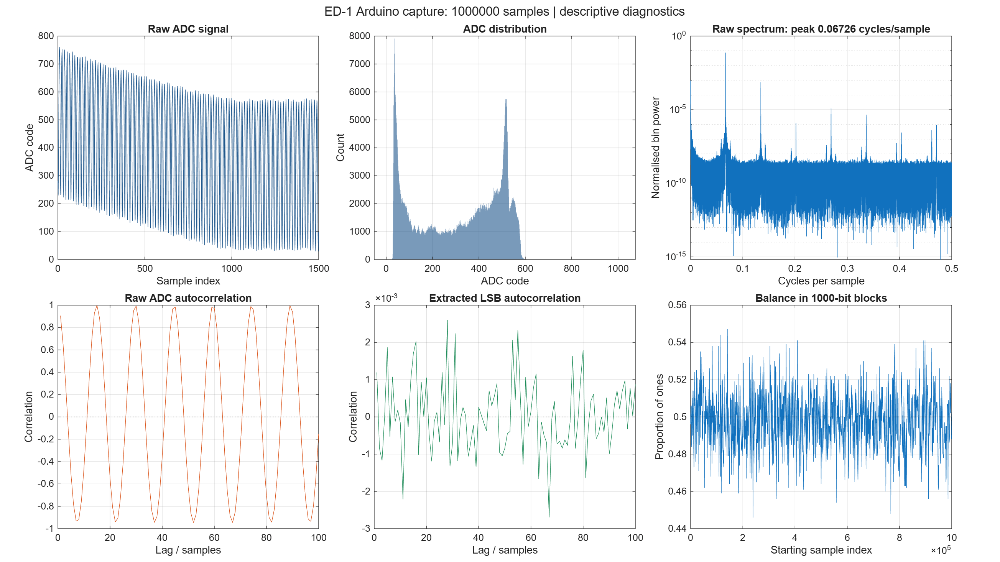

The [MATLAB source and instructions](software/matlab/README.md) explain how to
repeat the analysis. The [saved results](results/ED-1/matlab/README.md) include
the report, correlation CSV and editable figure. The MATLAB R2026b Update 1
results matched the Python audit, including all 101 exported correlation rows.
These are descriptive checks, not proof of quantum origin or secure entropy.

<a id="ed4pcb"></a>
## ED4 A Arduino PCB

The first ED 4 PCB is a two layer, 89 by 52 mm board for the enclosure already
printed. It brings the buffered reference, source selector, signal amplifier
and Arduino interface together with seven test points and a bottom ground fill.
The design uses through hole parts for assembly and inspection.

The [editable KiCad project](hardware/ED-4/pcb/ED4-A/ED4_A_Arduino.kicad_pro),
[schematic](hardware/ED-4/pcb/ED4-A/drawings/ED4_A_schematic.pdf) and
[board guide](hardware/ED-4/pcb/ED4-A/README.md) are available for review.
The revision B layout uses an MCP6002 and a standard 100k and 1k gain network.
It passes KiCad ERC, DRC and schematic parity checks. Circuit validation and
populated enclosure fit remain pending. The [purchase BOM](hardware/ED-4/pcb/ED4-A/BOM.csv)
records the chosen components.

I have also included the [JLCPCB Gerber ZIP, assembly BOM and placement file](hardware/ED-4/pcb/ED4-A/jlcpcb/README.md).
That assembly option covers 11 components. R3, R4, R6 and D1 would be fitted
by hand because they were unavailable in the assembly inventory. The removable
JP1 shunt is separate too. I may instead order the bare PCB and fit all the
components myself.

I also ran an [ngspice signal path check](hardware/ED-4/pcb/ED4-A/simulation/README.md)
with the PCB component values and a small injected test signal. The approximate
model shows the expected reference and gain at the Arduino input. It does not
model the LED noise or validate the entropy source.

ED4 A uses an external Arduino with a 5 V ADC interface. ED4 E is the planned
ESP32 revision and will have its own ADC and power interface review.

<a id="pcbviews"></a>
## ED4-A PCB views

These are KiCad views of the revision B design. They show the intended board
and component positions before manufacture. The 3D renders show R3, R4, R6
and D1 in place, although those parts are omitted from the optional JLCPCB
assembly order. C4 appears as a footprint because its 3D model is not shown.
The LED model is red in these views, but the BOM specifies a green LED.

### Routed layout

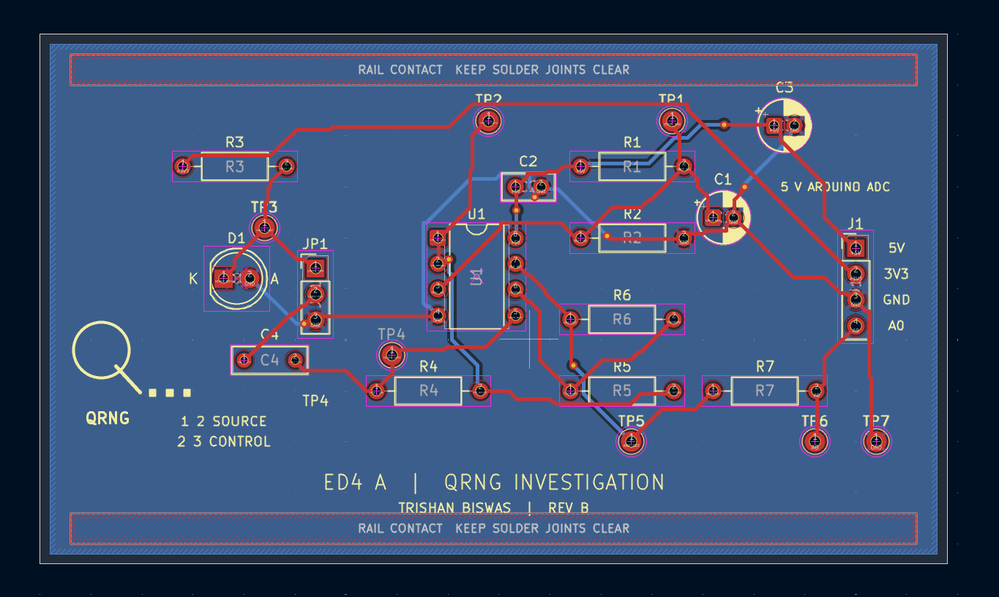

### Component renders

| Top view | Angled view |
|:---:|:---:|
| 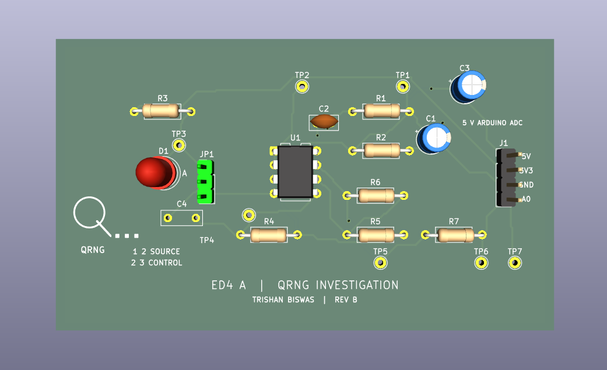 | 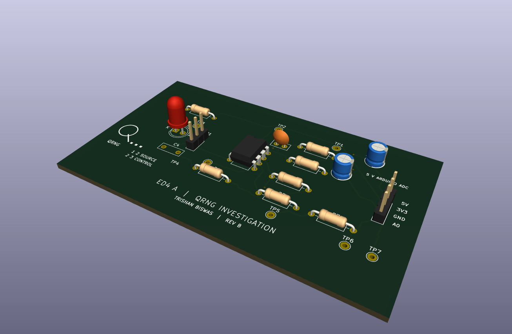 |

The renders show the planned layout, not a built board or a confirmed fit in
the printed enclosure.

<a id="ngspicechecks"></a>
## ngspice checks

I used ngspice to test the ED4 A analogue path with known inputs before
building the board. The [netlists, figures and method](hardware/ED-4/pcb/ED4-A/simulation/README.md)
are in the simulation folder. They use the PCB values and an approximate op amp
model. None of these runs models the LED noise or proves that the circuit will
produce useful entropy.

The first check used a 2 mV peak signal at 1 kHz and showed about 100 times
gain at the Arduino input. I then grounded the input and added a 100 mV peak,
100 Hz ripple to the 5 V rail. In that model A0 still moved by about 160 mV
peak, so the actual supply and grounded control will need careful measurement.

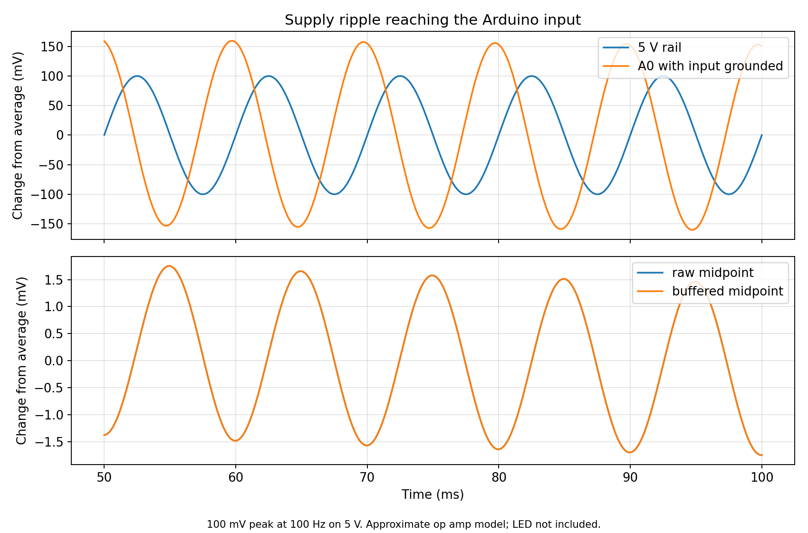

I also compared 2 mV and 40 mV peak test inputs. The smaller signal stayed
within the Arduino input range, while the larger one reached both output
limits in the model. The LED signal amplitude has not been measured yet.

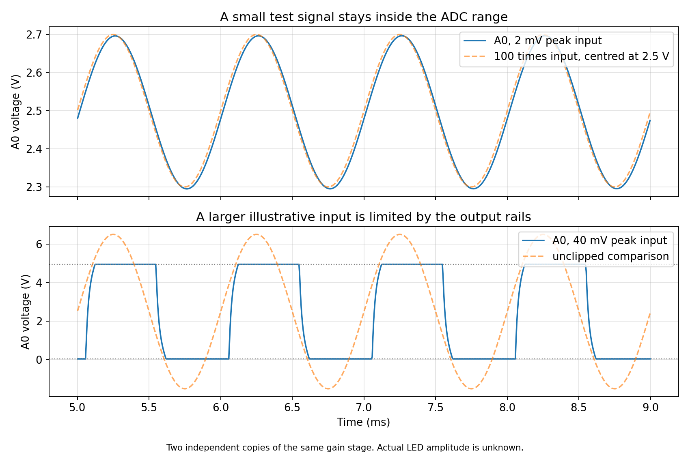

<a id="overview"></a>
## Overview

The project is organised into four stages. ED stands for Entropy Demonstrator;
the table distinguishes the completed work, archived prototypes and planned builds.

| Stage | Purpose | Current state |
|---|---|---|
| **ED-1** | Prove that the full path from circuit to saved data and analysis could work | Complete and preserved |
| **ED-2** | Explore a documented two-stage analogue path and acquisition process | Completed and preserved as a breadboard investigation; reference loading found during bring-up and recorded |
| **ED-3** | Validate a simpler buffered reference circuit on breadboard, with optional perfboard transfer afterwards | Design documented; assembly and validation pending |
| **ED-4** | Custom PCB for the existing printed enclosure | ED4 A Arduino layout available for review; 89 by 52 mm; bench and populated fit checks pending. ED4 E ESP32 revision planned |

The name QRNG describes the research direction. The present evidence supports an experimental physical entropy source, not a certified quantum random number generator or a source suitable for cryptographic use.

The investigation asks three practical questions:

1. Does the circuit produce measurable physical noise?
2. Can useful digital bits be extracted from it consistently?
3. Do the results survive repeat captures, restarts and control experiments?

Statistical tests can describe a bitstream, but they cannot identify its physical origin on their own. The circuit, sampling process and possible interference must be studied alongside the output.

<a id="terminology"></a>
## Quick terminology

| Term | Meaning in this project |
|---|---|
| **Entropy source** | A physical process being investigated as a possible source of unpredictable variation |
| **ADC reading** | A number produced when the Arduino converts the measured circuit voltage into a digital value |
| **Least significant bit** | The final binary digit of an ADC reading, recorded here as a candidate random bit |
| **Bitstream** | The resulting sequence of zeros and ones |
| **Software control** | A deterministic Mersenne Twister sequence used for comparison, not a NIST reference generator |
| **Bitstream Art** | Visuals drawn by custom Python programs whose choices are driven by the recorded ED-1 bits. No generative AI model was used |
| **ED** | Entropy Demonstrator |

The analysis checks balance, repetition, correlation and stability. A balanced output alone does not prove that the signal is quantum or secure.

<a id="development"></a>
## Development

I began the project in December 2025 because it combined semiconductor physics, analogue electronics, microcontroller sampling and Python analysis in one experiment.

In April 2026, ED-1 became the first complete demonstrator. It produced a saved sequence of one million ADC readings and one least significant bit from each reading. I then built a software control, generated comparison figures and ran exploratory statistical tests.

> [!IMPORTANT]
> The first result looked promising because the extracted bits were close to balanced. A later audit showed that the raw ADC sequence contained strong correlation and a repeating component. This did not make ED-1 useless. It made ED-1 a clear baseline and showed what the next version needed to improve.

ED-2 kept the original LED source idea but added a defined midpoint reference, two amplifier stages, clearer bias paths, supply decoupling and output protection. During systematic bring-up, the Stage A reference branch pulled the unbuffered midpoint from approximately 2.5 V to approximately 1.3 V. That result is preserved as part of the engineering record rather than presented as a validated improvement.

ED 3 starts again with a simpler topology. Its documented breadboard uses one
LM358 section to buffer the midpoint and the other as a signal amplifier. The
ED 4 PCB revision B uses a pin compatible MCP6002 and revised resistor values
to reduce input bias error. That component change needs its own bench checks.
After breadboard validation, the ED 3 circuit may also be transferred to
perfboard and checked again. ED 4 has a nominal 89 by 52 mm outline for the
enclosure already printed. The earlier
bare perfboard fit check establishes a starting board envelope; PCB tolerances,
component clearance and connector access still need checking.

<a id="ed1results"></a>
## ED 1 results

The preserved April 2026 capture contains 1,000,000 samples.

| Measurement | Result |
|---|---:|
| Ones | 497,767 |
| Zeros | 502,233 |
| Proportion of ones | 0.497767 |
| Binary Shannon entropy | 0.9999856 bits per bit |
| Most common value estimate | 0.9935713 bits per bit |
| Raw ADC range | 0 to 760 |
| Raw ADC lag 1 correlation | 0.9057 |
| Dominant raw period | approximately 14.87 samples |
| Extracted bit lag 1 correlation | 0.00119 |

The bit balance was encouraging, but the raw ADC correlation showed that the analogue signal contained substantial structure. The exploratory NIST STS run also reported failures in Frequency, Runs and forward Cumulative Sums. These results are kept in the repository because they are part of the engineering record.

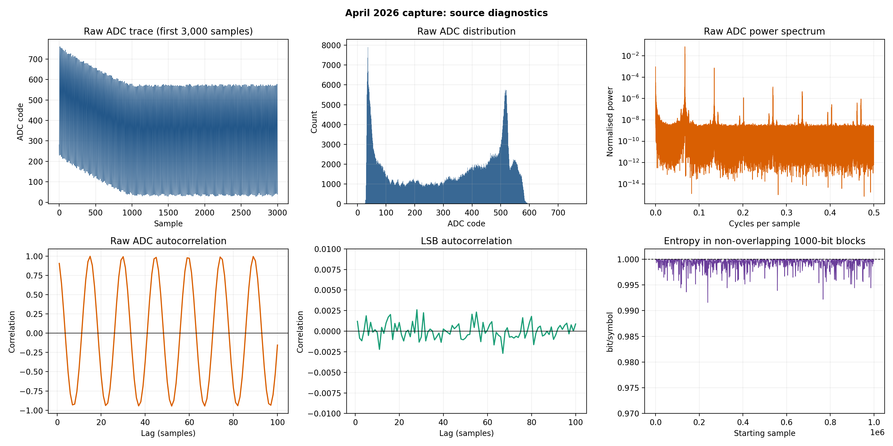


The full interpretation is recorded in [`docs/validation.md`](docs/validation.md).

<a id="ed2circuit"></a>
## ED 2 circuit

ED-2 uses the following signal path:

1. A green LED is connected as the proposed physical noise source.
2. A 2.5 V midpoint reference supports operation from a single 5 V supply.
3. Two LM358 noninverting stages amplify the alternating component of the signal.
4. A protected output feeds Arduino input A0.
5. The Arduino records each raw ADC code and its least significant bit.
6. A steady D7 indicator shows that the sampler is running without switching for every recorded bit.

The exact component values, breadboard positions, expected voltages and assembly order are documented in [`circuit.md`](circuit.md). The matching sampler is stored at [`firmware/ED-2/entropy_sampler_ed2.ino`](firmware/ED-2/entropy_sampler_ed2.ino).

ED-2 produced live ADC readings, but systematic probing exposed reference loading in the assembled topology. ED-2 is completed and preserved as an investigation with a documented design fault. It has no published validation dataset and is not a verified entropy source.

<a id="ed3circuit"></a>
## ED 3 circuit

ED-3 uses a buffered midpoint reference and one signal amplifier. The reduced
topology removes the second signal-gain stage and prevents the gain network from
directly loading the 10 kOhm midpoint divider.

The proposed component values, electrical netlist and staged bring-up sequence
are documented in [`hardware/ED-3/circuit.md`](hardware/ED-3/circuit.md). The
matching sampler is stored at
[`firmware/ED-3/entropy_sampler_ed3.ino`](firmware/ED-3/entropy_sampler_ed3.ino).
ED-3 will not be described as working until its reference, amplifier baseline,
source controls and repeat captures have been checked.

An optional perfboard version remains part of ED 3. It follows breadboard
validation and must repeat the electrical checks and control captures after
transfer.

<a id="ed4enclosure"></a>
## ED 4 PCB and printed enclosure

ED 4 combines a custom routed PCB with the existing two part enclosure. The base
was printed successfully, and an 89 by 52 mm bare perfboard fits between its
locating features. The PCB will use that nominal envelope, with a target
thickness of 1.6 mm. Its final fit must account for print tolerances, support
rails, solder joints, component height and cable access.

| Dimension | Value |
|---|---:|
| Nominal PCB target | 89 by 52 mm, 1.6 mm thick |
| Internal space | 105 by 68 by 34 mm |
| Approximate assembled exterior | 109.8 by 72.8 by 40 mm |
| Board support height | 8 mm |
| Clearance above the board | approximately 24.4 mm |
| Cable opening | 26 by 12 mm |

The existing cable opening was sized for an Arduino harness. The final PCB
connector and acquisition interface will follow the validated ED 3 circuit.

The [PCB plan](hardware/ED-4/pcb-plan.md) records the mechanical constraints,
intended features and checks required before fabrication.

The [ED4 A Arduino PCB](hardware/ED-4/pcb/ED4-A/README.md) is the current routed
review design. ED4 E will cover ESP32 separately. The board outline is shared;
the ADC and power interfaces must be reviewed for each revision.

The editable source, printable files, dimensions and print guidance are available in the [ED-4 CAD directory](hardware/ED-4/cad/README.md).

The current KiCad evidence is the [ED4 A schematic and routed PCB](hardware/ED-4/pcb/ED4-A/README.md).
The layout passes ERC, DRC and schematic parity checks. The earlier unfinished
perfboard placement draft has been superseded by this design.

| Printed ED-4 enclosure base | Initial perfboard fit check |
|:---:|:---:|
| 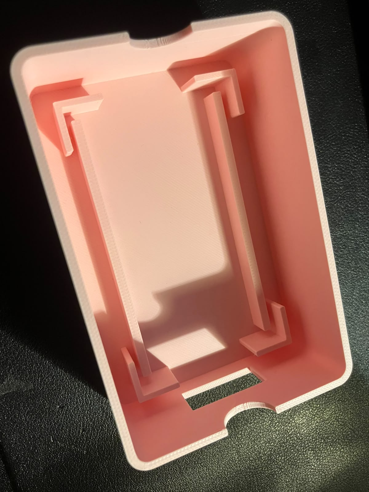 | 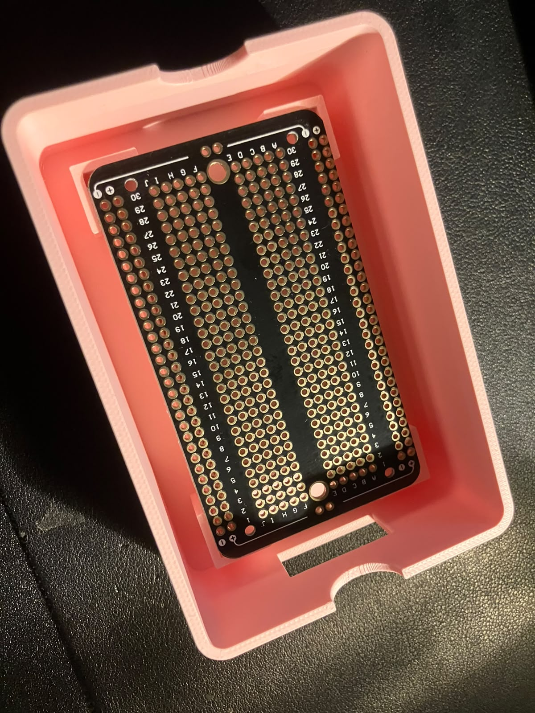 |
| The first physical print of the enclosure base and internal locating features. | An 89 by 52 mm bare perfboard establishing the initial envelope for the planned PCB. |

<a id="photographs"></a>
## Hardware photographs

The photographs keep the demonstrators visually separate so their wiring and mechanical progress cannot be mistaken for the same revision.

| ED-1 first demonstrator | ED-2 improved breadboard |
|---|---|
| 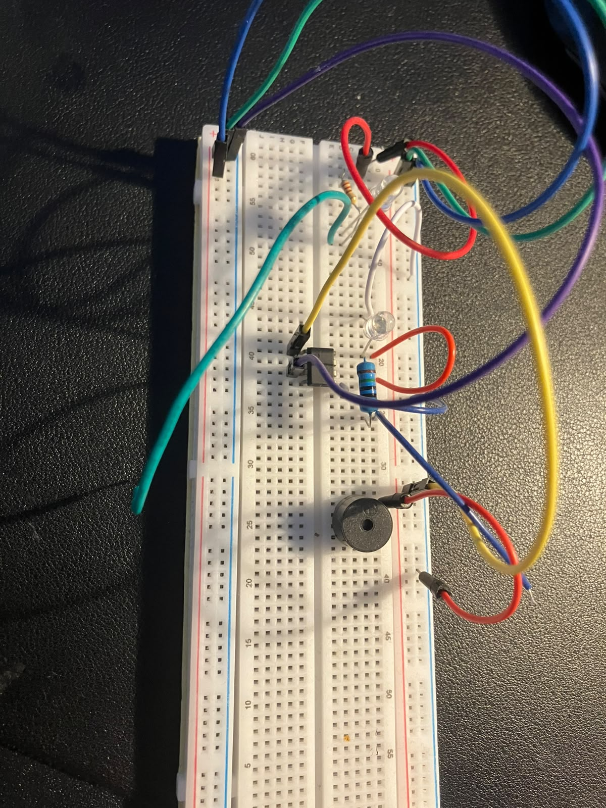 | 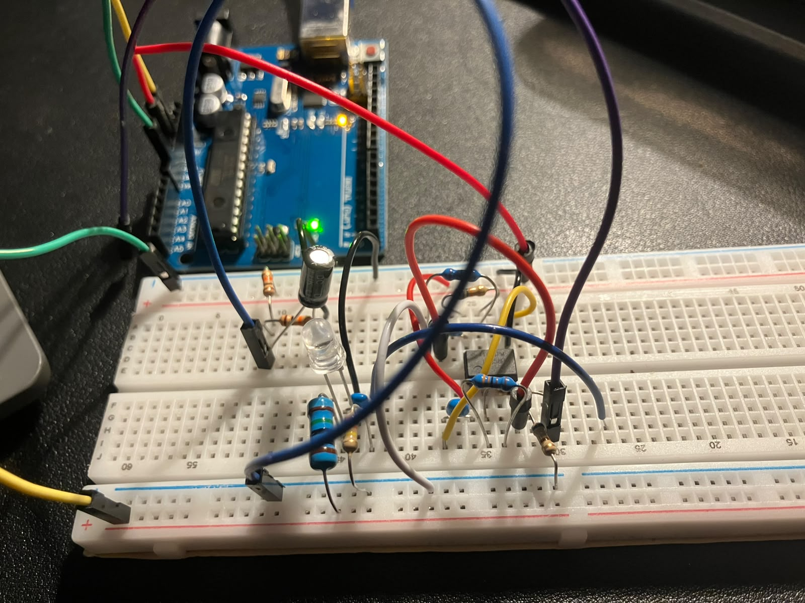 |
| Original breadboard used for the first complete acquisition and analysis path. | Wider view of the latest documented ED-2 breadboard with its Arduino connection. |

Additional views and captions are stored in the [ED-1 hardware notes](hardware/ED-1/README.md), [ED-2 hardware notes](hardware/ED-2/README.md) and [ED-4 enclosure notes](hardware/ED-4/README.md).

<a id="repositoryguide"></a>
## Repository guide

| Location | Contents |
|---|---|
| [`art/`](art/README.md) | Reproducible artwork driven by the saved ED-1 bits |
| [`data/`](data/README.md) | Preserved captures, controls and integrity hashes |
| [`docs/`](docs/development-log.md) | Development history, theory, limits, safety and validation plans |
| [`figures/ED-1/`](figures/ED-1/) | Figures generated from the April 2026 capture |
| [`firmware/`](firmware/README.md) | Arduino samplers separated by demonstrator |
| [`hardware/`](hardware/README.md) | Photographs, build records, the ED-3 circuit and ED-4 CAD |
| [`results/`](results/README.md) | The ED-1 audit and exploratory statistical output |
| [`software/`](software/) | Collection, analysis, comparison and extraction tools |
| [`tests/`](tests/) | Data, link, asset, analysis and CAD integrity tests |

<a id="analysis"></a>
## Reproducing the analysis

Install the Python dependencies from the repository root:

```bash
python -m pip install -r requirements.txt
```

Run the repository tests:

```bash
python -m unittest discover -s tests -v
```

Regenerate the ED-1 diagnostics and comparison:

```bash
python software/analyser.py
python software/compare.py
```

For the MATLAB version, see the [analysis section](#matlab) and its
[run instructions](software/matlab/README.md).

The exploratory NIST wrapper requires a separately installed NIST STS executable. Read [`docs/validation.md`](docs/validation.md) before interpreting its output.

<a id="collection"></a>
## Collecting new data

After ED-3 passes bring-up, upload the ED-3 sampler, confirm the serial port and run:

```bash
python software/collector.py --port COM3 --samples 1000000
```

Replace `COM3` with the port used by the Arduino. The collector writes a new timestamped CSV and a JSON metadata file under `data/ED-3/runs/`. A capture should not be published until the circuit values, firmware version, conditions and file hash have been recorded.

<a id="art"></a>
## Bitstream Art

The repository includes four artworks drawn deterministically from the ED-1 bitstream by custom Python programs. The recorded bits control visual choices such as paths, positions and colours. No generative AI model was used, and the artwork is not evidence of randomness quality.

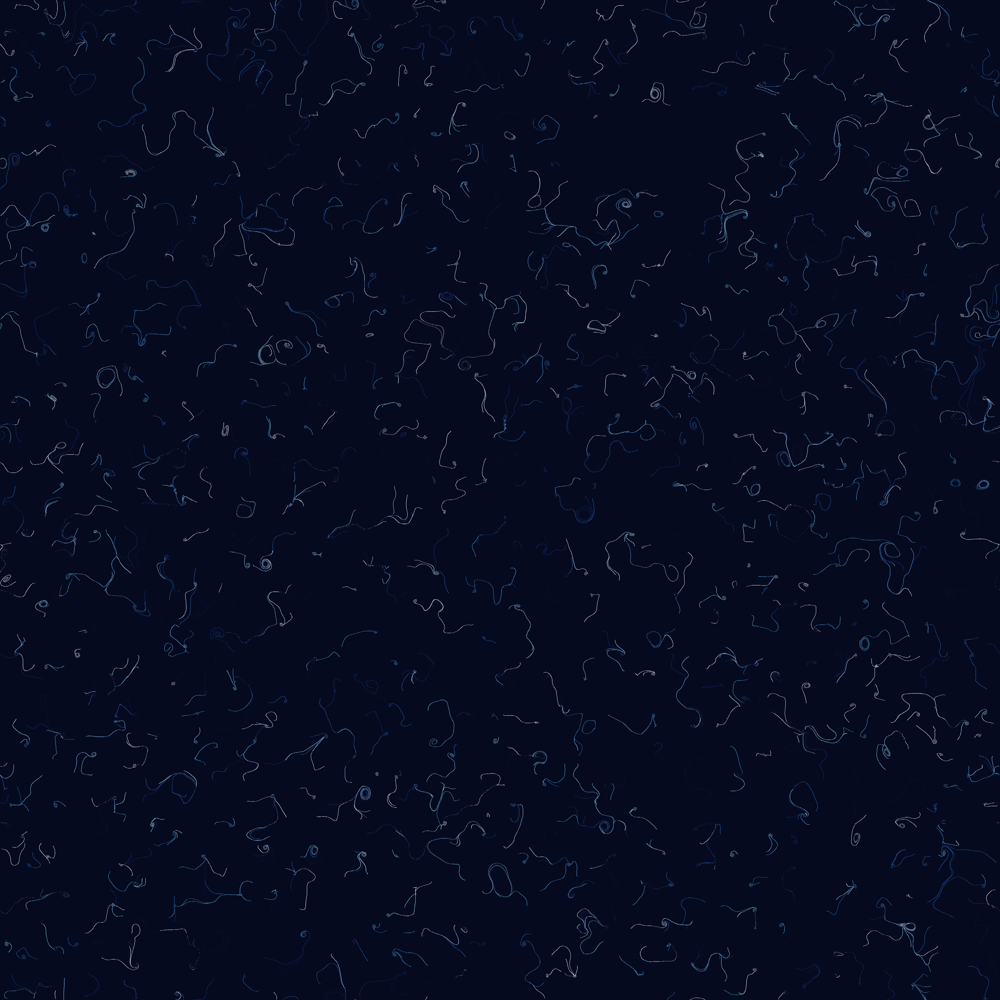

The images and reproducible source code are available in the [`art` gallery](art/README.md).

<a id="limits"></a>
## Limits

The project has not yet isolated the contribution of the LED from amplifier noise, converter behaviour, supply movement or environmental interference. ED-1 represents one capture, ED-2 exposed a reference-loading problem, and ED-3 still needs assembly and controlled testing.

> [!CAUTION]
> No output from this repository should be used for cryptographic keys, authentication, gambling, financial decisions or safety critical systems.

Read [`docs/limitations.md`](docs/limitations.md), [`docs/safety.md`](docs/safety.md) and [`SECURITY.md`](SECURITY.md) before reproducing the hardware.

<a id="nextwork"></a>
## Next work

1. Assemble ED-3 in tested stages, beginning with the buffered reference.
2. Record the final component values, node checks and build photographs.
3. Capture ED-3 controls and source runs across independent restarts.
4. Compare its raw signal structure, bias, correlation and stability with ED-1.
5. Establish a conservative entropy estimate before introducing conditioning.
6. Select the acquisition architecture from evidence; an Arduino, ESP32, or external ADC must not be treated as the entropy source.
7. Optionally transfer the validated ED 3 circuit to perfboard and repeat its checks.
8. Build the ED 4 PCB within the printed enclosure's 89 by 52 mm board envelope.

<a id="licence"></a>
## Licence

The hardware, analysis and documentation are released under the Apache License 2.0 in [`LICENSE`](LICENSE). The Bitstream Art directory retains its MIT licence in [`art/LICENSE`](art/LICENSE).
