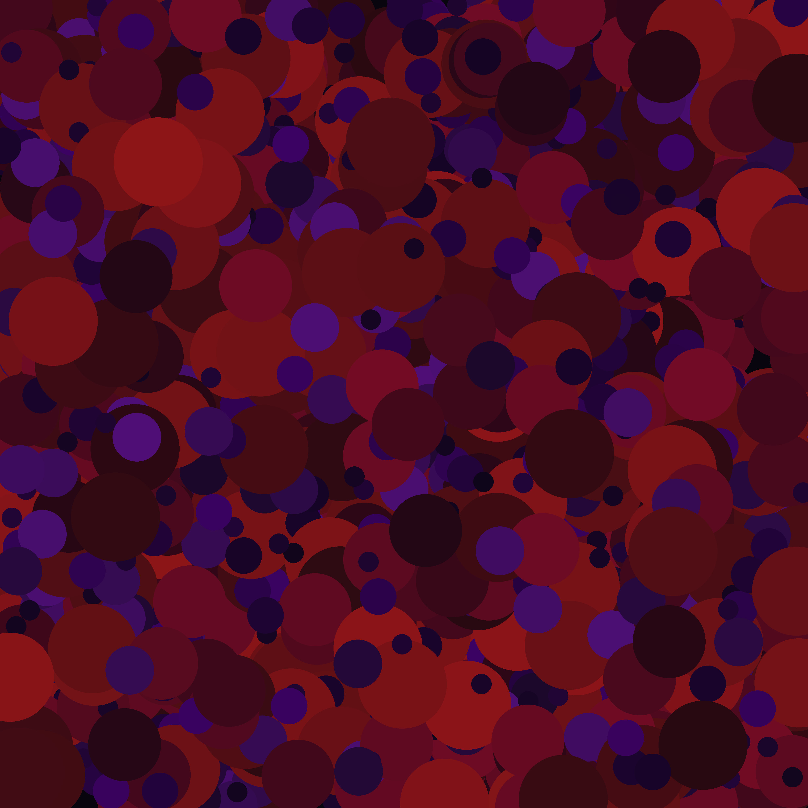
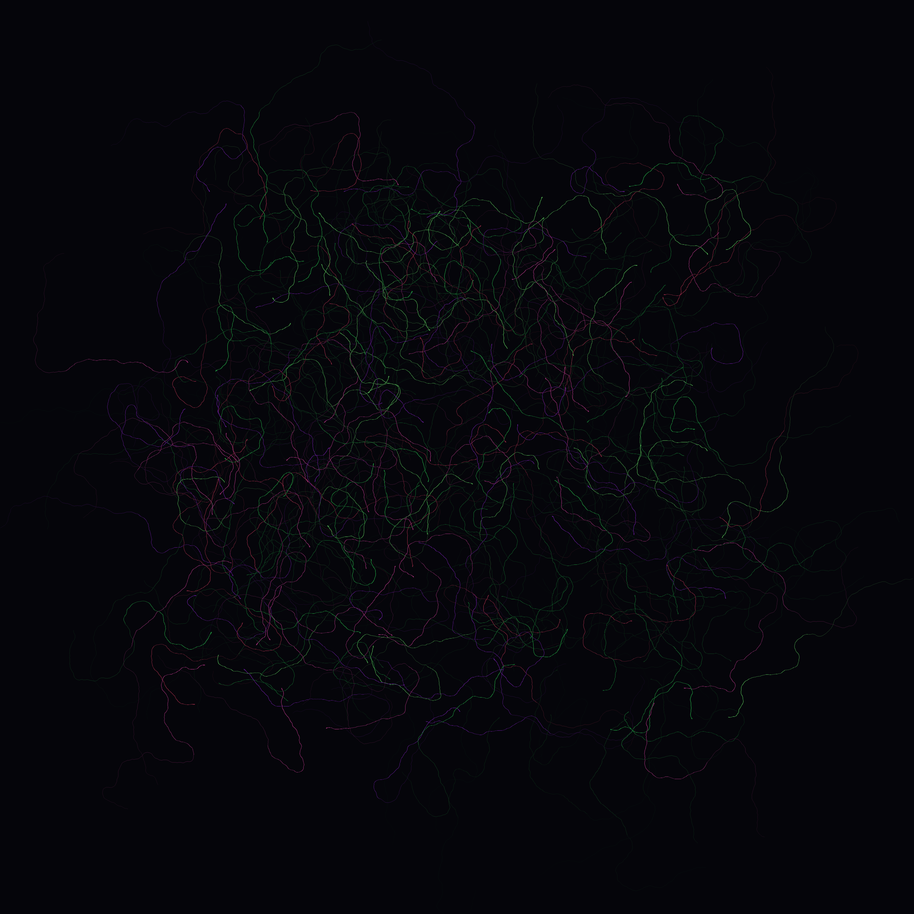
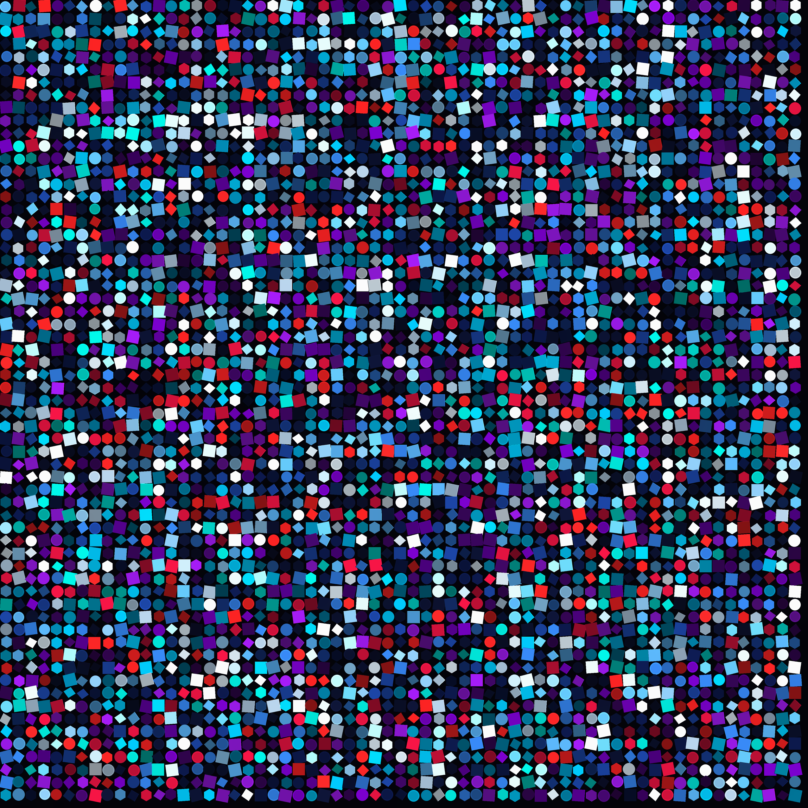

# Bitstream Art

This directory contains reproducible artwork drawn by custom Python programs using the recorded ED-1 bitstream. The saved bits control visual decisions in each program. No generative AI model was used.

The pieces are an artistic application of the dataset, not evidence that the source is quantum, independent, or suitable for cryptographic use. References to fields, particles, spectra, measurement, or wavefunctions are visual metaphors rather than physical simulations.

## Gallery

| | |
|---|---|
|  |  |
| **Quantum Fields** | **Quantum Circles** |
|  |  |
| **Quantum Walk** | **Quantum Mosaic** |

## Reproduce the images

Install the art dependencies from the repository root:

```bash
python -m pip install -r art/requirements.txt
```

Then run any piece:

```bash
python art/quantum_fields.py
python art/quantum_circles.py
python art/quantum_walk.py
python art/quantum_mosaic.py
```

The programs read `data/ED-1/qrng_bits.csv` through `qrng_source.py` and write 4000 by 4000 PNG files to `art/output/`. Given the same input and code, each image is reproducible.

`QRNGSource` consumes saved bits sequentially and supplies random operations to the drawing scripts. Integer selection uses rejection sampling to avoid modulo bias. Exhausting the input raises `QRNGExhausted`; the code never silently falls back to a pseudorandom generator.

The palette names are aesthetic references:

- **Cherenkov:** saturated blues;
- **Hydrogen:** colours inspired by visible hydrogen emission lines;
- **Aurora:** greens, reds, and purples; and
- **Schrodinger:** warm amber and cold teal.

## Licence

The contents of this `art/` directory are licensed under the MIT License in `art/LICENSE`.
