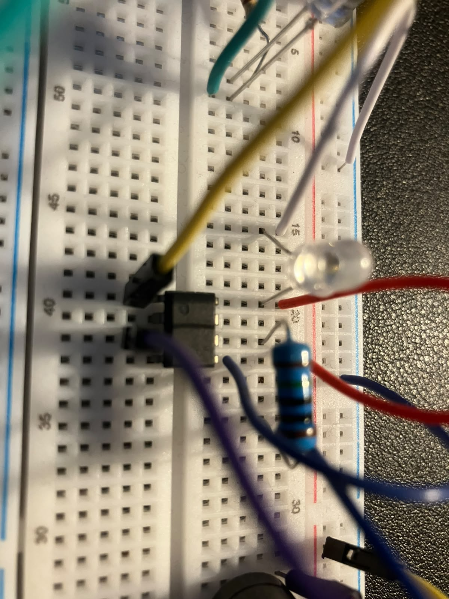

# ED-1 hardware

ED-1 is the original working demonstrator. It established the acquisition and analysis pipeline and produced the preserved April 2026 dataset.

Its photographs are historical evidence of that build. They must not be presented as photographs of ED-2, whose analogue path and status indicator differ.

## Photographs

### Breadboard overview

Top view of the first breadboard demonstrator, including its wired indicators and buzzer.

### Close view of the analogue stage

Close view of the original LM358 area, source LED and nearby connections.
