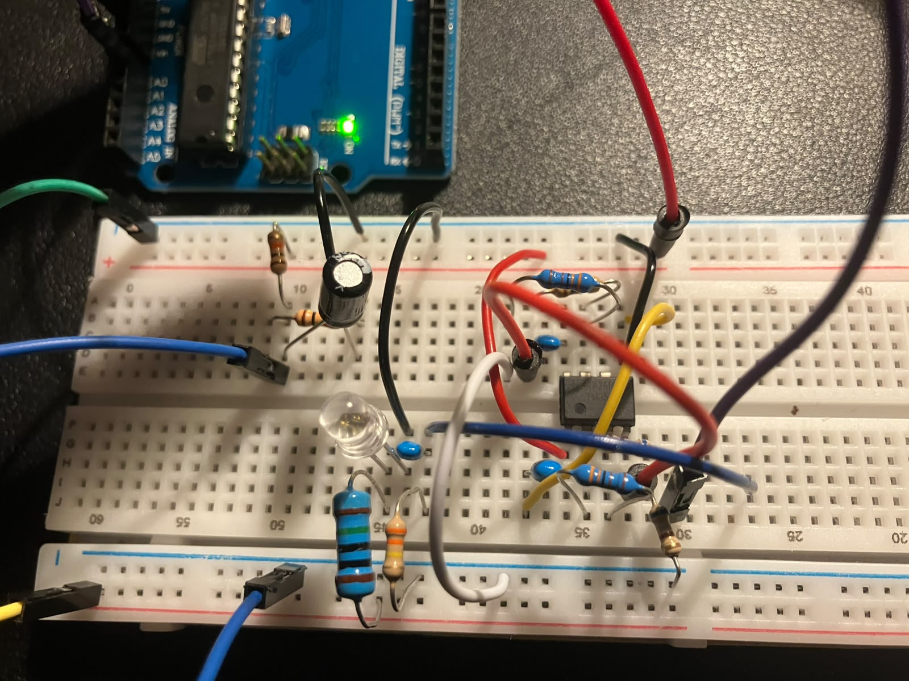
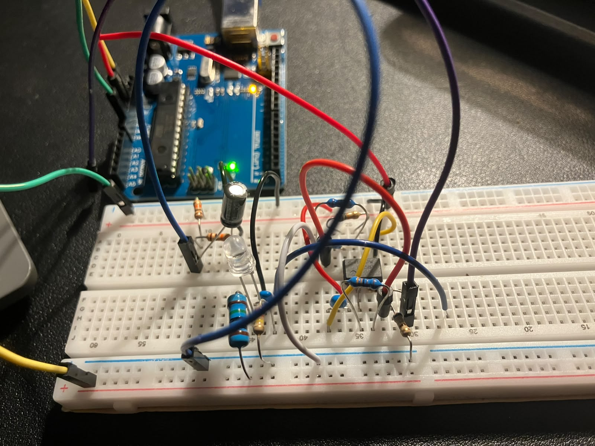
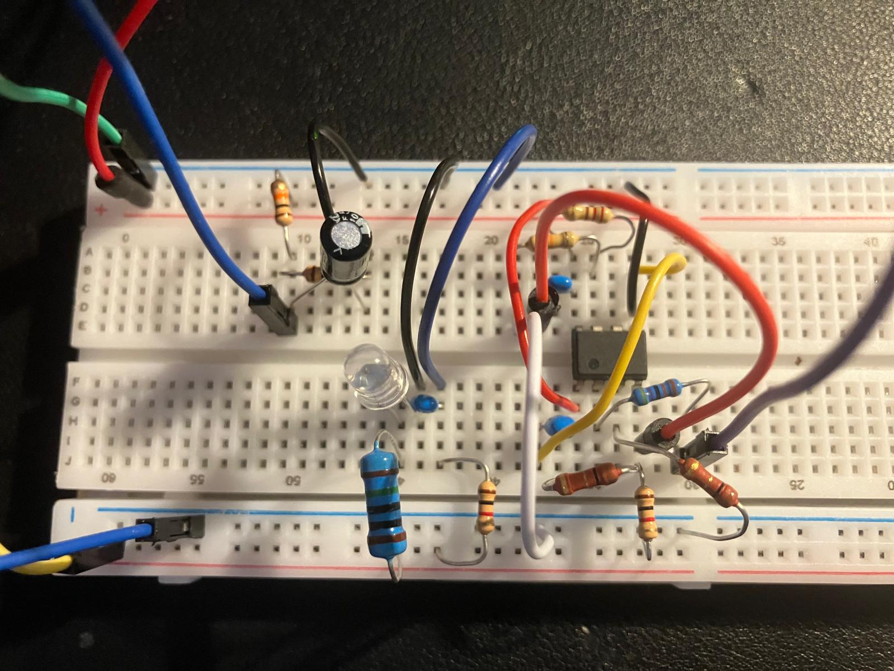
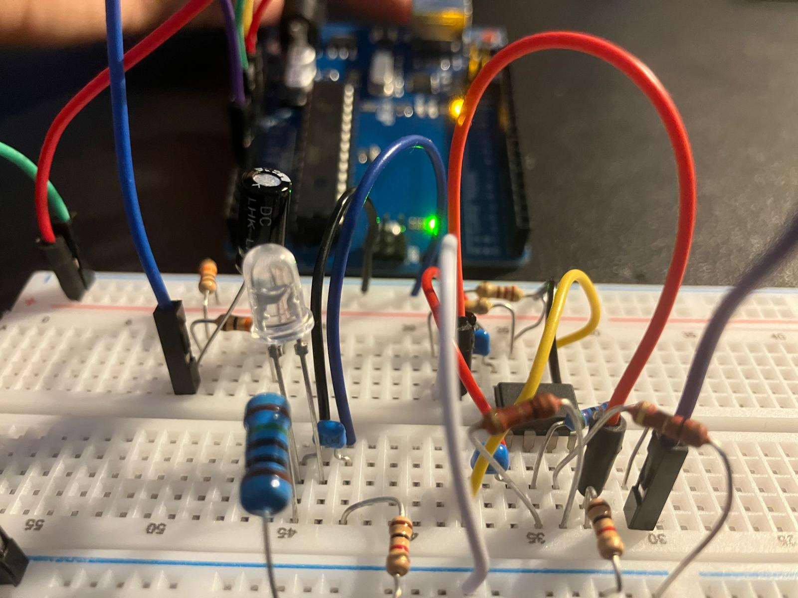

# ED-2 hardware

ED-2 is the improved breadboard demonstrator described by the root `circuit.md`. It adds a defined decoupled reference, two LM358 gain stages, an output protection resistor, and a separate D7 status LED.

ED-2 is complete as a breadboard investigation. During bring-up, the reference branch pulled the nominal 2.5 V midpoint to about 1.3 V. That finding led to the simpler ED 3 circuit and the ED 4 PCB work. The ED-2 circuit was not validated as an entropy source.

Successful ADC readings confirm basic connectivity, but they are not a substitute for a recorded dataset and analysis. Photo captions should identify the view and the documented circuit stage.

## Photographs

### Latest documented breadboard

Close view of the most recent documented ED-2 arrangement, photographed on 18 October 2026. This photograph records the hardware state only and is not evidence of a validated entropy source.

Wider view from 18 October 2026 showing the same breadboard arrangement with its Arduino connection.

### Breadboard overview

Earlier top view of the ED-2 breadboard showing the analogue layout during development.

### Close view of the analogue stage

Close view of the reference, LED source, LM358 stages and Arduino connection area.
