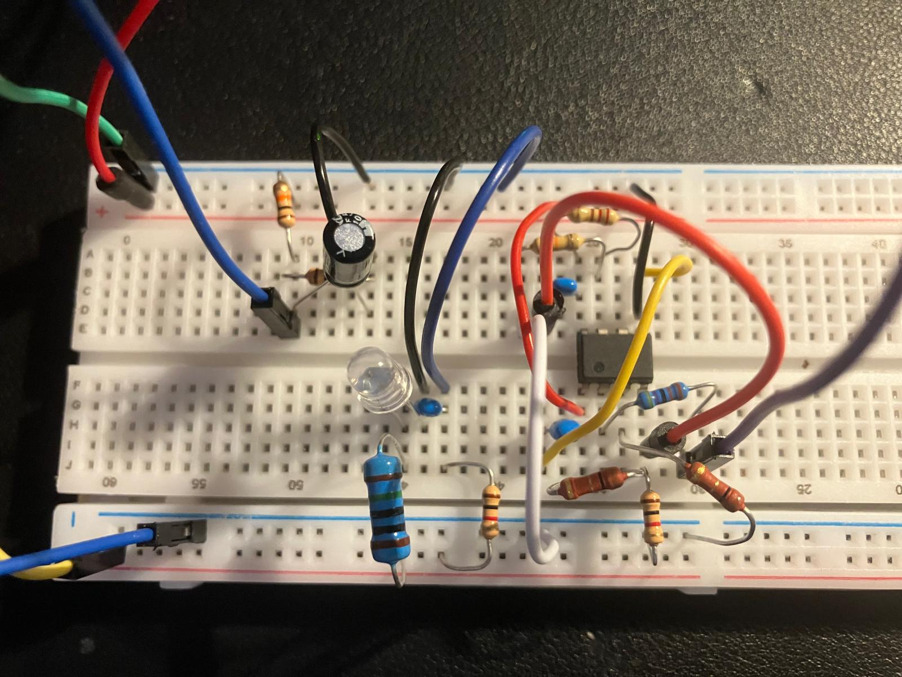
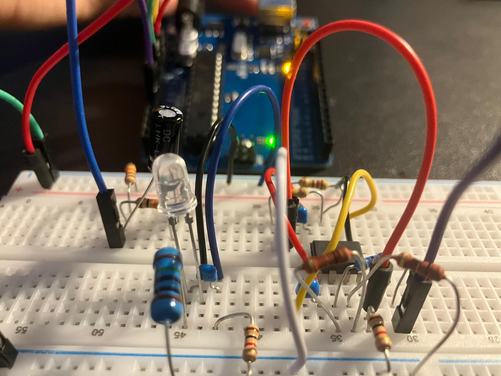

# ED-2 hardware

ED-2 is the improved breadboard demonstrator described by the root `circuit.md`. It adds a defined decoupled reference, two LM358 gain stages, an output protection resistor, and a separate D7 status LED.

Successful ADC readings confirm basic connectivity, but they are not a substitute for a recorded dataset and analysis. Photo captions should identify the view and the documented circuit stage.

## Photographs

### Breadboard overview

Top view of the ED-2 breadboard showing the complete analogue layout.

### Close view of the analogue stage

Close view of the reference, LED source, LM358 stages and Arduino connection area.
