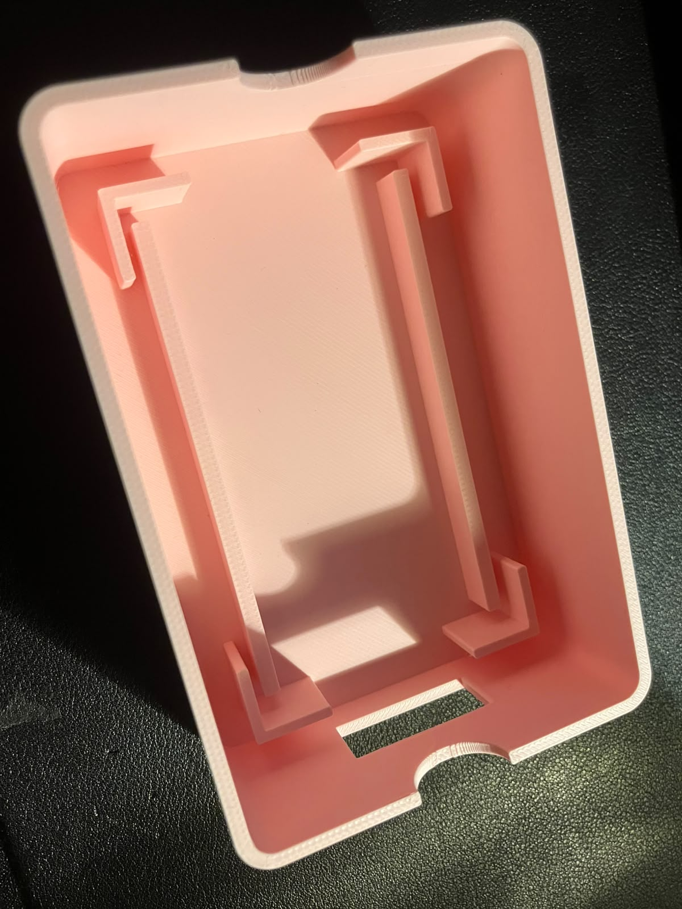
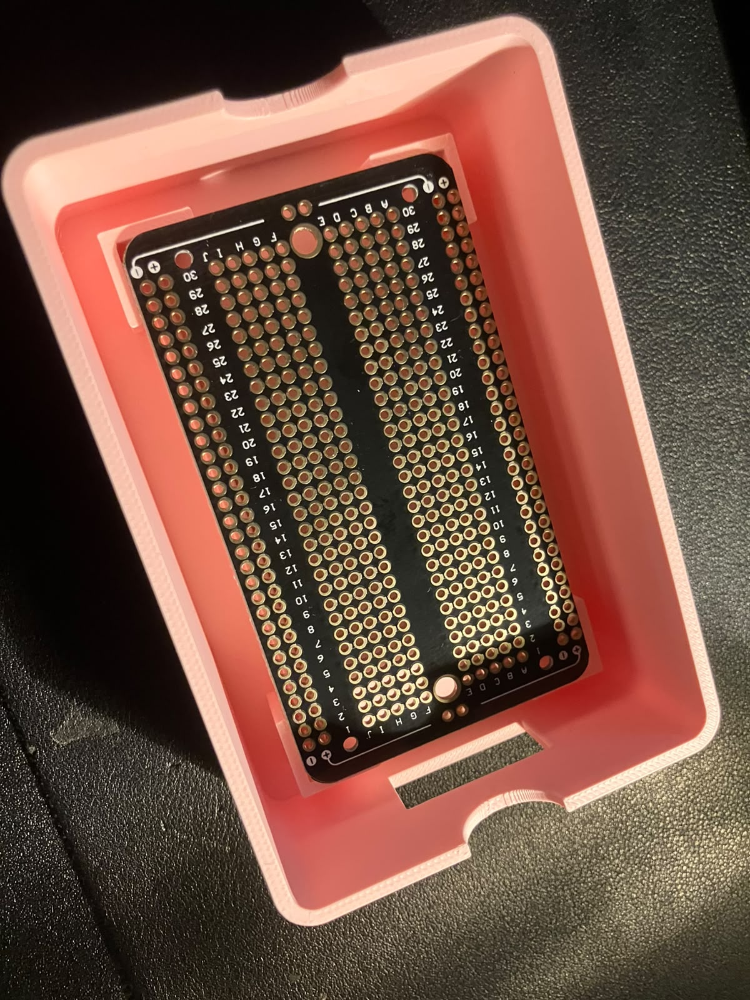

# ED 4 custom PCB and printed enclosure

ED 4 will implement the validated ED 3 circuit as a routed PCB inside the
enclosure already printed. The nominal PCB target is 89 by 52 mm and 1.6 mm
thick, matching the original board envelope in the enclosure CAD. Optional
perfboard assembly belongs to [ED 3](../ED-3/README.md).

The [PCB plan](pcb-plan.md) records the design constraints and checks before
fabrication. [ED4 A](pcb/ED4-A/README.md) is the Arduino review layout. ED4 E is
the planned ESP32 revision. Assembly, physical fit and electrical validation
remain pending.

The first base was printed and an 89 by 52 mm bare perfboard fits inside its
locating features. That check supports the initial PCB envelope. Final PCB fit,
component clearance, solder joints, lid fit and cable access still need checking.

## Current enclosure design

The parametric enclosure source is under [`cad/`](cad/README.md). It provides
34 mm of internal height and a 26 by 12 mm cable opening. Its board preview is
89 by 52 mm and 1.6 mm thick. The final connector and acquisition interface will
be selected from the validated circuit and checked against that opening.

The board rests on raised rails and is located by edge guides, so the design does not depend on unconfirmed positions for mounting holes. The lid uses a configurable locating lip held by friction for straightforward prototype printing.

## Printed fit prototype

| Empty enclosure base | Perfboard fit check |
|:---:|:---:|
|  |  |

The photographs were taken on 18 October 2026 and show the first physical base
with the unpopulated perfboard seated inside it. They establish the initial
mechanical envelope; they do not show the planned custom PCB.

## Current KiCad project

The [ED4 A Arduino project](pcb/ED4-A/README.md) contains the connected
schematic, routed PCB, BOM and assembly drawings. It supersedes the earlier
unfinished perfboard placement draft. The printed enclosure and bare board
fit photographs remain as the physical record behind the chosen board outline.
