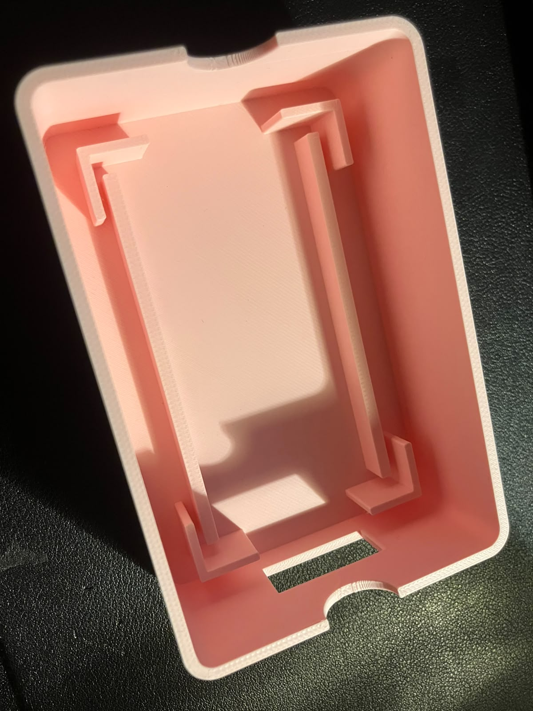
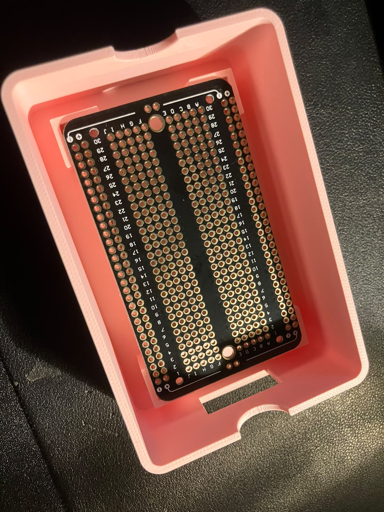

# ED-4 enclosure and perfboard plan

ED-4 is the planned mechanically stable implementation of the ED-3 topology after that breadboard has been tested. It is expected to use perfboard, labelled Arduino leads, strain relief, and a 3D printed enclosure.

The first base has now been printed and the intended 89 by 52 mm bare perfboard fits inside its locating features. This is evidence of mechanical fit only. The enclosure remains a prototype until populated-board clearance, ventilation, cable access, electrical isolation, serviceability and complete assembled operation have been checked.

## Current enclosure design

The first parametric enclosure source is under [`cad/`](cad/README.md). It is sized for an 89 by 52 mm perfboard, provides 34 mm of internal height, and has one opening for the Arduino harness. The simplified ED-3 topology currently requires 5 V, 3.3 V, GND and A0.

The board rests on raised rails and is located by edge guides, so the design does not depend on unconfirmed positions for mounting holes. The lid uses a configurable locating lip held by friction for straightforward prototype printing.

## Printed fit prototype

| Empty enclosure base | Perfboard fit check |
|:---:|:---:|
|  |  |

The photographs were taken on 18 October 2026 and show the first physical base with the unpopulated perfboard seated inside it. Component installation and electrical validation remain future work.
