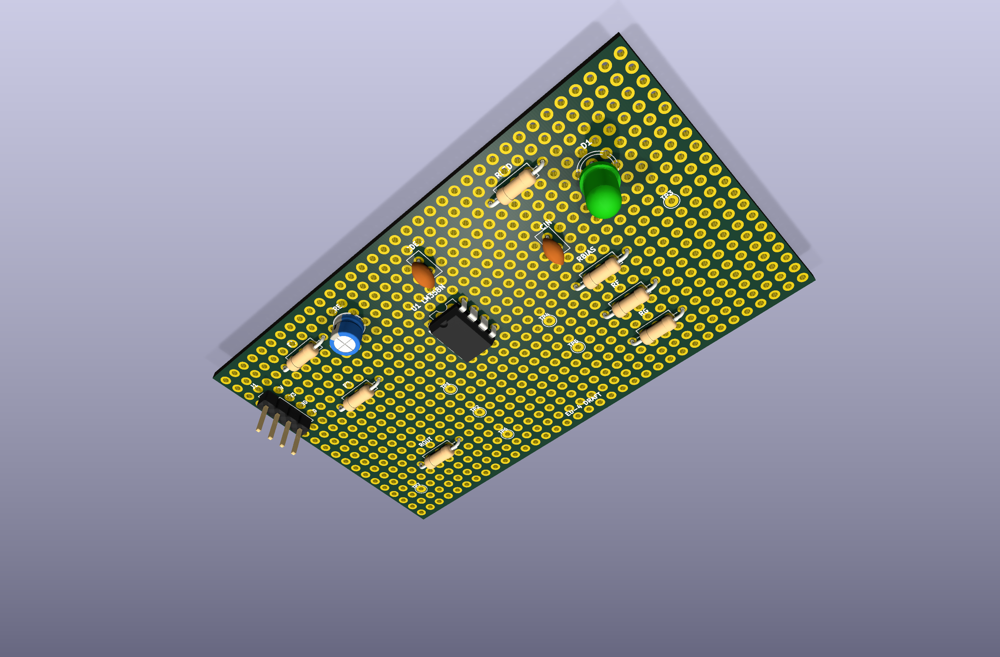
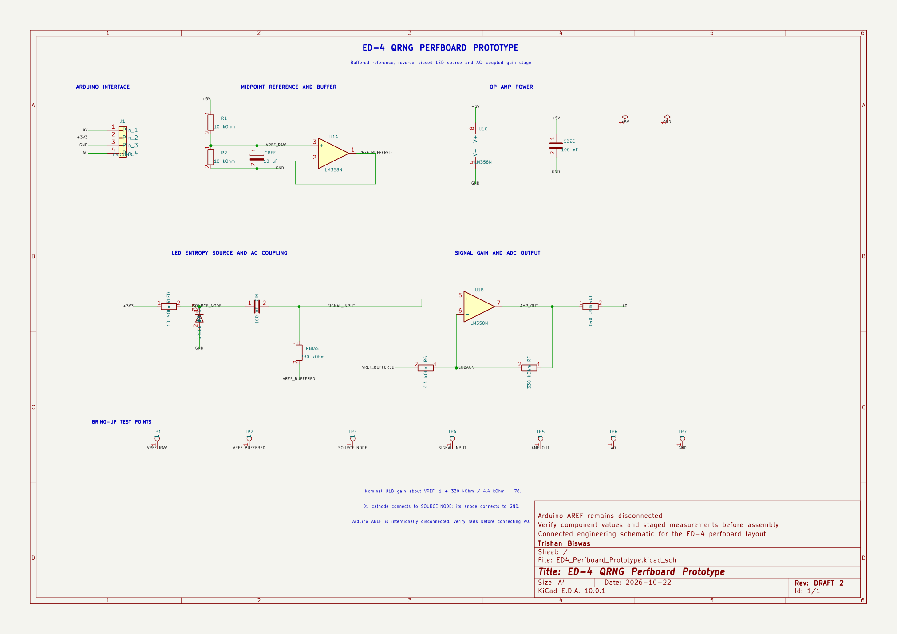

# ED-4 KiCad perfboard prototype

This directory contains an editable schematic and placement draft for transferring the proposed ED-3 buffered-reference circuit to the 89 by 52 mm ED-4 perfboard.

> [!IMPORTANT]
> This is a prototype layout, not an assembly-ready or validated circuit. ED-3 must first pass the documented voltage checks and controlled captures. The final ED-4 wiring should then be updated to match the circuit that was actually verified.

## Files

- `ED4_Perfboard_Prototype.kicad_pro`: KiCad project file.
- `ED4_Perfboard_Prototype.kicad_sch`: editable circuit schematic.
- `ED4_Perfboard_Prototype.kicad_pcb`: editable 89 by 52 mm perfboard placement.
- `exports/ed4-perfboard-prototype-isometric.png`: isometric KiCad render of the proposed component placement.
- `exports/ed4-perfboard-prototype-top.png`: top-view KiCad render for documentation.
- `exports/ed4-perfboard-prototype-bottom.png`: underside KiCad render for placement inspection.
- `exports/ed4-perfboard-prototype-layout.svg`: scalable 2D KiCad layout export.
- `exports/ed4-perfboard-prototype-schematic.pdf`: KiCad schematic export.
- `exports/ed4-perfboard-prototype-schematic.png`: quick schematic preview.
- `exports/ed4-schematic-erc.rpt`: KiCad electrical-rules report.
- `exports/ed4-perfboard-drc.rpt`: board-rules report for the unfinished perfboard model.
- `generate_ed4_perfboard.py`: reproducible board generator for KiCad's bundled Python environment.
- `generate_ed4_schematic.py`: reproducible schematic generator using KiUtils.
- `requirements-kicad.txt`: version-pinned schematic generator dependency.

## What the draft includes

- 35 by 20 hole grid at 2.54 mm pitch inside an 89 by 52 mm outline;
- LM358N in a DIP-8 package;
- 10 kOhm midpoint divider and 10 uF reference capacitor;
- LM358 voltage follower for `VREF_BUFFERED`;
- reverse-biased green LED source with a 10 MOhm feed resistor;
- 100 nF input coupling and supply decoupling capacitors;
- 330 kOhm bias and feedback resistors, 4.4 kOhm gain resistor and 690 Ohm A0 protection resistor;
- labelled test points for staged bring-up; and
- a four-wire Arduino connection for 5 V, 3.3 V, GND and A0.

Component placement and net assignments are included. Permanent jumper and solder-side routing is deliberately not finalised because ED-3 has not yet been electrically validated.

| Isometric placement render | Connected circuit schematic |
|:---:|:---:|
|  |  |

The schematic passes KiCad ERC with 0 errors and 0 warnings. This checks schematic consistency, not whether the proposed entropy source will perform as intended in hardware.

The board renders are placement previews. They are not wiring diagrams and must not be used as the sole assembly reference. The current DRC report contains expected violations because the model includes the complete drilled perfboard grid and does not yet include the final solder-side links. It should not be interpreted as a fabrication-ready routed PCB.

## Regenerating the board

From this directory on Windows:

```powershell
& "C:\Program Files\KiCad\10.0\bin\python.exe" .\generate_ed4_perfboard.py
```

Open `ED4_Perfboard_Prototype.kicad_pro` in KiCad 10 after generation. Before physical assembly, check the installed component dimensions, confirm LED polarity, rerun ERC and DRC, and reconcile every net against the verified breadboard.

To regenerate the schematic, install its small file-format dependency and run:

```powershell
python -m pip install -r .\requirements-kicad.txt
python .\generate_ed4_schematic.py
& "C:\Program Files\KiCad\10.0\bin\kicad-cli.exe" sch upgrade --force .\ED4_Perfboard_Prototype.kicad_sch
```
