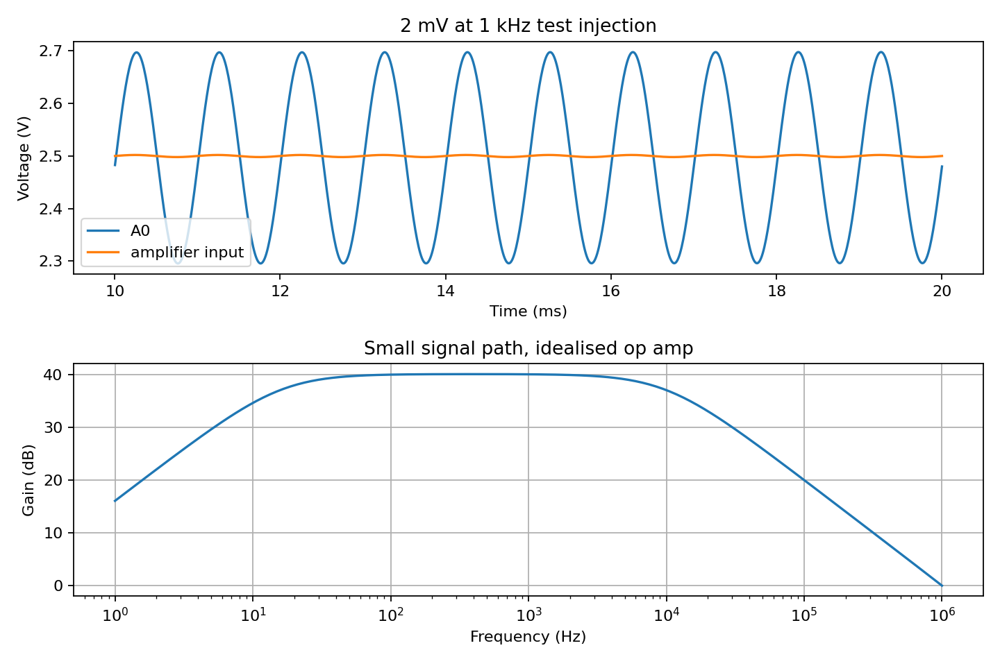

# ED4 A signal path simulation

I used ngspice to check the analogue path in the revision B PCB before ordering it. The test puts a known 2 mV peak, 1 kHz signal into the coupling capacitor through JP1 pin 2. This lets me check the reference, gain and output range without treating the LED as a known noise source.

| Check | Simulated result |
| --- | --- |
| Midpoint reference | 2.500 V raw and about 2.500 V buffered |
| Arduino A0 with the test signal | About 2.497 V average with a 0.201 V peak swing |
| Gain around 1 kHz | About 100 times |
| Low frequency corner | Around 16 Hz, set mainly by C4 and R4 |
| Upper corner | Around 10 kHz in this approximate model |

The [netlist](ed4a_signal_path.cir) uses the PCB resistor and capacitor values and a simple one pole op amp approximation. It is **not** Microchip's MCP6002 model. The Arduino input is represented by a light load, and the LED noise, board parasitics and USB supply noise are not modelled. The plot shows how the intended amplifier path responds to an injected signal. It does not establish that the physical LED produces useful entropy or that the populated board will work as a QRNG.

To repeat the check with a command line installation of ngspice, open this folder in a terminal and run `ngspice ed4a_signal_path.cir`. The netlist writes transient and AC data to local text files. The graph is a saved view of those outputs. The next meaningful check is a breadboard measurement with the LED source and the grounded input control, followed by raw Arduino captures.
