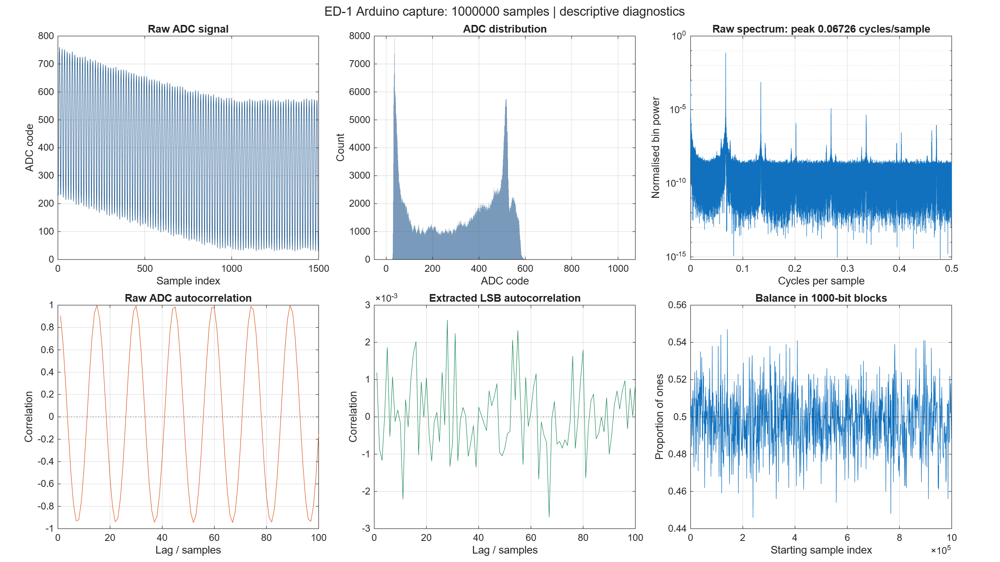

# MATLAB analysis of the April capture

This analysis uses the original Arduino capture of one million ADC readings and
their least significant bits. It plots the recorded signal, ADC distribution,
spectrum, autocorrelation and bit balance in blocks of 1000 samples.

The analysis completed in MATLAB R2026b Update 1. The actual exports were reviewed
on 5 November 2026. The report matched the saved Python audit and a fresh analysis
of the original CSV. All 101 exported correlation rows also matched.



The [saved results](../../results/ED-1/matlab/README.md) include the report,
summary, correlation values and editable MATLAB figure.

## Run it

MATLAB R2020a or later is required. No extra toolboxes are needed.
From the repository root:

```matlab
addpath(fullfile(pwd, 'software', 'matlab'));
report = analyse_ed1;
```

For a folder containing the script, CSV and reference file:

```matlab
report = analyse_ed1('qrng_bits.csv', 'output');
```

The original CSV is at `data/ED-1/qrng_bits.csv`. Keep its `raw` and `bit`
columns together. The script checks the ADC range, confirms each bit matches
the ADC reading, and compares its results with the saved reference JSON.

## Output files

1. `output/ed1_matlab_diagnostics.png` contains the six plots.
2. `output/ed1_matlab_diagnostics.fig` keeps the editable MATLAB figure.
3. `output/ed1_matlab_report.json` records the results and MATLAB version.
4. `output/autocorrelation.csv` contains the raw and bit correlations.
5. `output/summary.txt` contains the printed summary.

## What the results show

The proportion of ones is 0.497767 and the marginal binary Shannon entropy is
0.9999856 bits per symbol. However, the raw ADC correlation at lag 1 is about
0.9057, and its strongest spectral component repeats every 14.87 samples.
The extracted bits are nearly balanced even though the original signal has
substantial structure.

Frequency is in cycles per sample because the CSV has no timestamps or confirmed
sampling rate. The spectrum uses a Hann window and normalised bin power.
The autocorrelation uses FFT padding to prevent circular wrap and accounts for
the number of overlapping samples at each lag.

These results describe this capture. Marginal bit balance does not measure the
entropy rate, and the plots do not establish quantum origin or security.

Input SHA256:
`84f9276dd0746fe06ef0f60ca0d3a2b98d365a43feaad63ccd2901a173a689d0`
